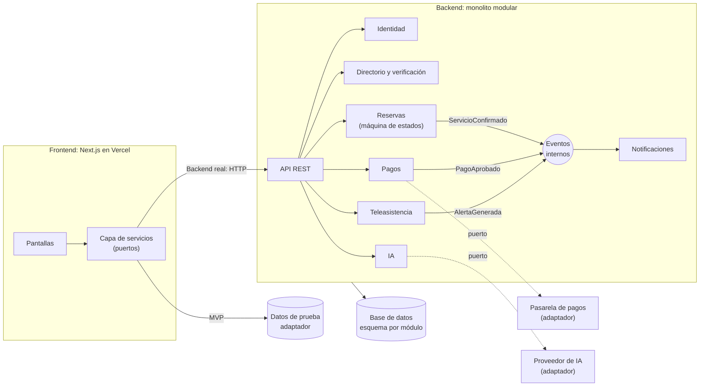

# Arquitectura y escenarios de calidad (ADR) — Seniory

| Campo | Valor |
|---|---|
| **Proyecto** | Seniory — *Creciendo y cuidando juntos* |
| **Equipo de desarrollo** | Michael Stiven Zuleta Hernández, Alejandro Múnera Jaramillo |
| **Equipo empresarial** | María Paulina Mazo Restrepo, Juan Manuel Herrera Gaviria |
| **Curso** | Arquitectura de Software |
| **Fecha** | 2026-10-11 |

> ## 🏛️ Arquitectura seleccionada
>
> ### Monolito modular por capas + arquitectura hexagonal (puertos y adaptadores)
>
> *Complementos: eventos de dominio internos y máquina de estados para el servicio de cuidado.*
>
> **¿Por qué?**
>
> - **Seguridad:** los datos de salud viven en un solo módulo con control de acceso por rol.
> - **Mantenibilidad:** cada módulo tiene fronteras claras, y los proveedores externos (pagos, IA, datos) se cambian sin tocar el dominio.
> - **Fiabilidad:** pagos y estados del servicio se actualizan en transacciones locales, sin la consistencia eventual de los microservicios.
> - **Tamaño del equipo:** con dos desarrolladores, un solo despliegue de backend evita la carga operativa de los microservicios, y los módulos dejan abierta la puerta para separarlos si el producto crece.
>
> Detalle completo en el [ADR 001](#4-adr-001-selección-de-estilo-arquitectónico).

**Contenido**

1. [Descripción del sistema](#1-descripción-del-sistema)
2. [Requisitos no funcionales priorizados](#2-requisitos-no-funcionales-priorizados)
3. [Escenarios de calidad](#3-escenarios-de-calidad)
4. [ADR 001: Selección de Estilo Arquitectónico](#4-adr-001-selección-de-estilo-arquitectónico)
5. [Referencias](#5-referencias)

---

## 1. Descripción del sistema

Seniory es una plataforma web responsive que conecta a familias con cuidadores verificados para adultos mayores. Hoy ese cuidado se contrata por WhatsApp y voz a voz, sin una forma confiable de verificar certificaciones ni disponibilidad.

**Funcionalidades principales**

- **Directorio de cuidadores verificados:** búsqueda con filtros y perfiles con verificación de antecedentes, títulos y prueba psicotécnica.
- **Contratación de servicios** por horas o turnos, con seguimiento del estado del servicio y calificación al finalizar.
- **Teleasistencia:** alertas de emergencia, recordatorios de medicamentos y signos vitales visibles para la familia.
- **Pagos** del servicio.

**Actores:** familiar responsable, adulto mayor y cuidador.

**Restricciones relevantes para la arquitectura**

- Se manejan **datos de salud**, que la Ley 1581 de 2012 clasifica como datos sensibles [3].
- Parte de los usuarios son **adultos mayores**, así que la accesibilidad es obligatoria.
- **Equipo de desarrollo de dos personas** y plazo de un semestre académico.
- El MVP es una aplicación **Next.js desplegada en Vercel**, con datos de prueba detrás de una capa de servicios intercambiable.

---

## 2. Requisitos no funcionales priorizados

Los atributos siguen el modelo **ISO/IEC 25010:2023** [1][2]. La columna *Peso en la arquitectura* indica cuánto influyó cada atributo en la elección del estilo arquitectónico (sección 4).

| Prioridad | Atributo | Subcaracterísticas | Por qué importa en Seniory | Escenarios | Peso en la arquitectura |
|---|---|---|---|---|---|
| **1** | **Seguridad** | Confidencialidad, autenticidad, integridad, rendición de cuentas | Datos de salud (sensibles por ley), identidad de los cuidadores y dinero | E6, E7 | **Alto** |
| **2** | **Mantenibilidad** | Modularidad, modificabilidad, capacidad de prueba | Equipo pequeño, producto que crecerá (backend real, nuevos servicios, IA) y proveedores externos que pueden cambiar | E12, E13, E14 | **Alto: es el que más define el estilo** |
| **3** | **Fiabilidad** | Ausencia de fallos, disponibilidad, recuperabilidad | Las familias deben poder encontrar, contratar y pagar sin errores | E1, E2, E3 | **Alto** (integridad); la disponibilidad es la principal tensión |
| **4** | **Adecuación funcional** | Corrección funcional, completitud funcional | El usuario debe completar la contratación de principio a fin, con el cobro correcto | E8, E9, E10 | Medio |
| **5** | **Capacidad de interacción** | Facilidad de aprendizaje, inclusividad | Usuarios con poca experiencia digital, incluidos adultos mayores | E4, E5 | Medio (se resuelve sobre todo en la capa de presentación) |
| **6** | **Eficiencia de desempeño** | Comportamiento temporal | Las alertas de teleasistencia deben llegar a tiempo | E11 | Medio |

---

## 3. Escenarios de calidad

Cada escenario sigue el formato de seis partes: fuente, estímulo, artefacto, entorno, respuesta y medida. Las medidas son metas del equipo y se validarán durante las pruebas del MVP.

### 3.1 Resumen

| ID | Atributo | Escenario | Medida |
|---|---|---|---|
| E1 | Fiabilidad | Ausencia de fallos en el uso | < 2 % de solicitudes con error del servidor por semana |
| E2 | Fiabilidad | Disponibilidad | ≥ 99 % mensual |
| E3 | Fiabilidad | Integridad de pagos | 0 cobros duplicados |
| E4 | Capacidad de interacción | Facilidad de aprendizaje | 90 % lo logra en < 3 min; perfil en ≤ 2 toques |
| E5 | Capacidad de interacción | Inclusividad para adultos mayores | Lighthouse Accesibilidad ≥ 90 |
| E6 | Seguridad | Protección de datos clínicos | 0 accesos no autorizados exitosos |
| E7 | Seguridad | Verificación del cuidador | 100 % de perfiles no verificados bloqueados |
| E8 | Adecuación funcional | Publicación de solicitud de cuidado | 100 % llegan a los cuidadores correctos en < 5 s |
| E9 | Adecuación funcional | Cierre del ciclo de contratación | 100 % de cambios de estado correctos |
| E10 | Adecuación funcional | Cálculo correcto del costo | 100 % de casos de prueba correctos |
| E11 | Eficiencia de desempeño | Alerta de teleasistencia | < 30 s en el 95 % de los casos |
| E12 | Mantenibilidad | Cambio de proveedor externo | 0 archivos del dominio modificados |
| E13 | Mantenibilidad | Nuevo tipo de servicio | 0 dependencias cíclicas entre módulos |
| E14 | Mantenibilidad | Pruebas del dominio aisladas | 100 % sin infraestructura real |

### 3.2 Fiabilidad

#### E1 — Ausencia de fallos en el uso de la plataforma

| Parte | Descripción |
|---|---|
| Fuente | Familias y cuidadores |
| Estímulo | Uso normal de las funciones principales: buscar cuidador, contratar y pagar |
| Artefacto | Módulos Directorio, Reservas y Pagos |
| Entorno | Operación normal en producción |
| Respuesta | Las solicitudes se procesan correctamente y, si algo falla, el usuario recibe un mensaje claro |
| Medida | Menos del 2 % de las solicitudes terminan en error del servidor, medido por semana |

#### E2 — Disponibilidad de los servicios

| Parte | Descripción |
|---|---|
| Fuente | Fallo interno (caída del servidor, de la base de datos o de un proveedor externo) |
| Estímulo | Un componente deja de responder |
| Artefacto | Plataforma completa |
| Entorno | Producción |
| Respuesta | Se detecta la falla, el usuario ve un aviso de mantenimiento y el servicio se restablece |
| Medida | Disponibilidad mensual ≥ 99 % (máximo ~7,2 h sin servicio al mes) |

#### E3 — Integridad de pagos

| Parte | Descripción |
|---|---|
| Fuente | Familia |
| Estímulo | Paga un servicio y la conexión se interrumpe, o el pago se reintenta |
| Artefacto | Módulo Pagos |
| Entorno | Operación normal en producción |
| Respuesta | El pago se registra una sola vez y los saldos quedan consistentes |
| Medida | 0 cobros duplicados; 100 % de las transacciones conciliadas entre la pasarela de pagos y el registro interno |

### 3.3 Capacidad de interacción

#### E4 — Facilidad de aprendizaje

| Parte | Descripción |
|---|---|
| Fuente | Familiar que usa la plataforma por primera vez |
| Estímulo | Quiere consultar los cuidadores disponibles |
| Artefacto | Interfaz web responsive |
| Entorno | Usuario nuevo, sin capacitación previa |
| Respuesta | Encuentra y consulta los cuidadores sin ayuda |
| Medida | En una prueba de usabilidad, el 90 % de los participantes lo logra en menos de 3 minutos; filtrar y abrir un perfil toma como máximo 2 toques |

#### E5 — Inclusividad para adultos mayores

| Parte | Descripción |
|---|---|
| Fuente | Adulto mayor o familiar con poca experiencia digital |
| Estímulo | Realiza una tarea principal (buscar un cuidador o revisar la teleasistencia) |
| Artefacto | Interfaz web responsive |
| Entorno | Uso normal |
| Respuesta | La interfaz usa texto de 18 px o más, objetivos táctiles de 48 × 48 px o más, contraste WCAG 2.1 AA [14], modo de alto contraste, tamaño de texto ajustable y comando de voz cuando el navegador lo soporta |
| Medida | Lighthouse Accesibilidad ≥ 90 en las pantallas principales; ≥ 90 % de tareas completadas sin ayuda en una prueba con adultos mayores |

### 3.4 Seguridad

#### E6 — Protección de datos clínicos sensibles

| Parte | Descripción |
|---|---|
| Fuente | Usuario malintencionado (interno o externo) |
| Estímulo | Intento de acceso no autorizado a la información de salud del adulto mayor |
| Artefacto | Módulo Identidad y usuarios / base de datos de perfiles |
| Entorno | Operación normal, en producción |
| Respuesta | El sistema bloquea el acceso, no expone la información y registra el intento. Solo la familia vinculada y el cuidador contratado ven los datos de salud, y su tratamiento requiere autorización explícita del titular (Ley 1581 de 2012, art. 6) [3] |
| Medida | 0 accesos no autorizados exitosos; intento registrado en menos de 1 segundo |

#### E7 — Verificación del cuidador antes de ser visible

| Parte | Descripción |
|---|---|
| Fuente | Cuidador en proceso de registro |
| Estímulo | Intenta completar su perfil sin documento de identidad o certificación válida |
| Artefacto | Módulo Directorio y verificación |
| Entorno | Proceso de registro, condiciones normales |
| Respuesta | El perfil no queda visible ni disponible para contacto hasta que la verificación sea aprobada |
| Medida | 100 % de los perfiles no verificados quedan bloqueados para contacto |

### 3.5 Adecuación funcional

#### E8 — Publicación de una solicitud de cuidado *(funcionalidad posterior al MVP)*

| Parte | Descripción |
|---|---|
| Fuente | Familia |
| Estímulo | Publica una solicitud con los datos requeridos (necesidad y ubicación) |
| Artefacto | Módulo Reservas |
| Entorno | Condiciones normales de uso |
| Respuesta | La solicitud queda visible solo para cuidadores verificados que cumplen el filtro de zona y especialidad |
| Medida | 100 % de las solicitudes válidas llegan a los cuidadores correctos y se publican en menos de 5 segundos |

#### E9 — Cierre correcto del ciclo de contratación

| Parte | Descripción |
|---|---|
| Fuente | Familia |
| Estímulo | Contrata a un cuidador |
| Artefacto | Módulos Reservas y Notificaciones |
| Entorno | Condiciones normales |
| Respuesta | El servicio pasa por los estados `Solicitado → Aceptado → EnCurso → Finalizado` (o `Cancelado`), se notifica a ambas partes en cada cambio y se habilita la calificación al finalizar |
| Medida | 100 % de los cambios de estado se reflejan correctamente para ambas partes |

#### E10 — Cálculo correcto del costo del servicio

| Parte | Descripción |
|---|---|
| Fuente | Familia |
| Estímulo | Contrata a un cuidador por un número de horas |
| Artefacto | Lógica de precios (`lib/pricing.ts` en el MVP; módulo Pagos en el backend) |
| Entorno | Condiciones normales de uso |
| Respuesta | La familia ve el subtotal, el cargo de servicio y el total, calculados con una función pura |
| Medida | 100 % de los casos de prueba unitarios del cálculo coinciden con el valor esperado antes de cada despliegue |

### 3.6 Eficiencia de desempeño

#### E11 — Alerta de teleasistencia

| Parte | Descripción |
|---|---|
| Fuente | Servicio de monitoreo / teleasistencia |
| Estímulo | Se genera una alerta sobre el adulto mayor |
| Artefacto | Módulos Teleasistencia y Notificaciones |
| Entorno | Operación normal en producción |
| Respuesta | El familiar responsable y el cuidador asignado reciben la alerta |
| Medida | Notificación entregada en menos de 30 segundos en el 95 % de los casos. En la demo del MVP, el flujo simulado (con cuenta regresiva cancelable de 5 s) se completa en menos de 10 s |

### 3.7 Mantenibilidad

#### E12 — Cambio de proveedor externo

| Parte | Descripción |
|---|---|
| Fuente | Equipo de desarrollo |
| Estímulo | Se necesita cambiar la pasarela de pagos, el proveedor de IA o la fuente de datos |
| Artefacto | Adaptador del módulo afectado |
| Entorno | Desarrollo |
| Respuesta | El cambio se hace solo en el adaptador; el dominio no se modifica |
| Medida | 0 archivos del dominio modificados; las pruebas del dominio pasan sin cambios |

#### E13 — Agregar un nuevo tipo de servicio

| Parte | Descripción |
|---|---|
| Fuente | Equipo de desarrollo |
| Estímulo | Se agrega un nuevo tipo de servicio o un módulo nuevo |
| Artefacto | Monolito modular |
| Entorno | Desarrollo |
| Respuesta | El cambio queda dentro del módulo nuevo o afectado; los demás módulos solo se tocan a través de su interfaz pública |
| Medida | 0 dependencias cíclicas entre módulos; ningún módulo accede a las tablas de otro |

#### E14 — Pruebas del dominio en aislamiento

| Parte | Descripción |
|---|---|
| Fuente | Desarrollador |
| Estímulo | Ejecuta las pruebas unitarias del dominio |
| Artefacto | Dominio de los módulos Reservas, Pagos y Teleasistencia |
| Entorno | Máquina local o integración continua |
| Respuesta | Las pruebas corren sin base de datos ni servicios externos, usando dobles de los puertos |
| Medida | 100 % de las pruebas del dominio se ejecutan sin infraestructura real |

---

## 4. ADR 001: Selección de Estilo Arquitectónico

| Campo | Valor |
|---|---|
| **Estado** | Aceptado |
| **Fecha** | 2026-10-11 |
| **Decisores** | Michael Stiven Zuleta Hernández y Alejandro Múnera Jaramillo (equipo de desarrollo) |
| **Consultados** | María Paulina Mazo Restrepo y Juan Manuel Herrera Gaviria (equipo empresarial) |
| **Reemplaza a** | — |
| **Reemplazado por** | — |

> Esta decisión puede cambiar en el futuro. Si cambia, se crea un ADR nuevo que la reemplace y este se marca como *Reemplazado*.

### 4.1 ¿Qué es un ADR?

Un **ADR (Architectural Decision Record)** documenta **una** decisión arquitectónica y su justificación: por qué se eligió, qué se sacrificó y qué consecuencias trae. El conjunto de ADRs de un proyecto forma su *decision log* [4].

Michael Nygard popularizó el formato en 2011 con cinco partes: **título**, **contexto**, **decisión**, **estado** (propuesto, aceptado, obsoleto o reemplazado) y **consecuencias**, todas y no solo las positivas. Recomendó guardarlos numerados en el repositorio del proyecto y conservar los antiguos marcados como reemplazados cuando una decisión cambia [5].

### 4.2 Contexto

**Fuerzas en juego**

- **Equipo pequeño y plazo corto:** dos personas en desarrollo y un semestre académico.
- **Datos sensibles:** información de salud del adulto mayor y pagos.
- **Accesibilidad obligatoria:** parte de los usuarios son adultos mayores.
- **Evolución esperada:** el MVP actual (Next.js en Vercel, con datos de prueba) debe poder pasar a un backend real y crecer con nuevos servicios sin reescribirse.
- **Integraciones externas que pueden cambiar:** pasarela de pagos, proveedor de IA, servicios de notificación.

**Requisitos no funcionales que impulsan la decisión** (sección 2)

1. **Seguridad:** proteger los datos de salud y garantizar que solo cuidadores verificados sean visibles.
2. **Mantenibilidad:** cambiar proveedores, agregar servicios y probar el dominio sin tocar el resto del sistema.
3. **Fiabilidad:** pagos íntegros y estados del servicio siempre consistentes.

**Diferencia con Uber.** El modelo de una app de cuidado se parece al de las apps "uberizadas", pero Uber despacha en segundos, a escala global y con conductores en movimiento. Seniory programa servicios por horas o turnos, así que su emparejamiento es mucho menos exigente en latencia y no necesita la infraestructura distribuida de Uber.

**Antecedentes revisados**

| Empresa | Qué hizo (según las fuentes) | Lección |
|---|---|---|
| **Uber** | Empezó como monolito (~2009), pasó a microservicios al crecer y llegó a ~2.200 microservicios críticos; para ordenarlos creó una arquitectura orientada a dominios (DOMA) [6][7] | Los microservicios llegan con la escala, y también traen su propio desorden |
| **Uber — fulfillment** | Rediseñó su plataforma con **máquinas de estado** por entidad porque las operaciones sobre varias entidades no eran atómicas [8] | Modelar el ciclo de vida del servicio como máquina de estados |
| **Airbnb** | Migró de un monolito a SOA porque los *rollbacks* costaban ~15 h por semana por ingeniero; cada servicio es dueño de sus datos y publica eventos al cambiarlos [9] | Definir fronteras de dominio desde el inicio |
| **Rappi** | Retiró su monolito en 2021; hoy opera miles de servicios con ~750 desarrolladores [10] | Es la escala a la que los microservicios compensan |
| **Shopify** | Decidió **no** partir su monolito y lo dividió en 37 componentes con dueño y fronteras verificadas [11] | Precedente directo del **monolito modular** |
| **Prime Video** | Un servicio pasó de serverless distribuido a una sola unidad desplegable, con ~90 % menos de costo de infraestructura [12] | Distribuir tiene costo y no siempre conviene |

### 4.3 Decisión

**Adoptamos un monolito modular organizado por capas, con arquitectura hexagonal (puertos y adaptadores) dentro de cada módulo de dominio.** Como complementos usamos **eventos de dominio internos** y una **máquina de estados** para el ciclo de vida del servicio de cuidado.

### 4.4 Por qué esta arquitectura

| Requisito priorizado | Cómo lo satisface la decisión | Escenarios |
|---|---|---|
| **Seguridad** | El módulo Identidad centraliza autenticación y control de acceso por rol. Los datos de salud viven en un solo módulo y ningún otro accede a sus tablas. | E6, E7 |
| **Mantenibilidad: modificabilidad** | Con la arquitectura hexagonal, la pasarela de pagos, el proveedor de IA y la fuente de datos son adaptadores; cambiarlos no toca el dominio. | E12 |
| **Mantenibilidad: modularidad** | Cada módulo tiene una interfaz pública y sus propias tablas. Agregar un servicio no rompe los demás. | E13 |
| **Mantenibilidad: capacidad de prueba** | El dominio no depende de la infraestructura y se prueba con dobles de los puertos. | E10, E14 |
| **Fiabilidad: integridad** | Al estar en un solo despliegue, pagos y saldos se actualizan en una transacción local, sin la consistencia eventual que exigirían los microservicios. | E3 |
| **Adecuación funcional** | La máquina de estados garantiza transiciones válidas del servicio, y los eventos internos notifican a ambas partes. | E9, E11 |
| **Tamaño del equipo y plazo** | Un solo código y un solo despliegue de backend evitan la carga operativa de red, observabilidad y despliegues múltiples. | — |

### 4.5 Estilos evaluados

Se evaluaron los 18 estilos de la matriz comparativa del curso [13].

| Estilo | Encaje en Seniory | Motivo |
|---|---|---|
| **Capas / N-Tier** | ✅ Base elegida | Separa presentación, aplicación y dominio |
| **Hexagonal** | ✅ Dentro de cada módulo | Aísla el dominio de proveedores externos (E12, E14) |
| **Monolítica (modular)** | ✅ Forma de despliegue | Simplicidad y transacciones locales (E3); fronteras por módulo (E13) |
| **Basada en eventos (EDA)** | ➕ Complemento | Eventos internos para notificaciones y alertas (E9, E11) |
| **Broker** | ➕ Cuando haga falta | Llegaría con un EDA distribuido |
| **MVC** | ➕ En la interfaz | Next.js organiza la presentación; no alcanza como arquitectura global |
| **Contenedores** | ➕ Opcional | Docker para reproducir el entorno; sin orquestador |
| **Serverless** | ➕ Puntual | Útil para tareas aisladas; poco apto para pagos con estado |
| **Agentes de IA** | ➕ Módulo aislado | Detrás de un puerto, sin mezclarse con el núcleo |
| **Microservicios** | ⏳ Evolución futura | Su costo operativo no se justifica con dos desarrolladores |
| **SOA** | ⏳ Etapa intermedia posible | Servicios pesados y orquestación compleja según la matriz |
| **Microkernel** | ⏳ Idea futura | Para tipos de servicio como extensiones |
| **Máquinas virtuales** | ❌ No aplica | El hosting es gestionado |
| **Bare metal** | ❌ Descartado | Sin necesidad de hardware propio |
| **Peer-to-Peer** | ❌ Descartado | El sistema requiere un servidor central confiable |
| **Pizarra, PAC, Objetos Desnudos** | ❌ Descartados | No corresponden al tipo de problema |

*Leyenda:* ✅ elegido · ➕ complemento · ⏳ evolución futura · ❌ descartado

### 4.6 Alternativas descartadas

| Alternativa | Por qué se descarta |
|---|---|
| **Microservicios desde el inicio** | Con dos desarrolladores, el costo operativo (red, observabilidad, consistencia eventual, despliegues múltiples) supera el beneficio. Pondría en riesgo la integridad de pagos (E3) al exigir transacciones distribuidas. |
| **Serverless puro** | Pagos y estados del servicio necesitan estado y transacciones consistentes; la matriz lo señala como poco ideal para tareas con estado. |
| **SOA** | Servicios pesados y orquestación compleja; no resuelve un problema actual. |
| **Monolito plano (sin módulos)** | Rápido al inicio, pero acopla todo y no cumple los escenarios de mantenibilidad (E12, E13). |

### 4.7 Módulos y vista general

| Módulo | Responsabilidad |
|---|---|
| **Identidad y usuarios** | Registro, autenticación, roles y perfil del adulto mayor |
| **Directorio y verificación** | Perfiles de cuidadores y verificación (antecedentes, títulos, psicotécnica) |
| **Reservas** | Contratación, ciclo de vida del servicio (máquina de estados) y calificación |
| **Pagos** | Cálculo del costo, cobros y liquidaciones |
| **Teleasistencia** | Alertas, medicamentos y signos vitales |
| **Notificaciones** | Avisos a familias y cuidadores |
| **IA** | Funciones de IA (alcance por definir) |



En el MVP, el frontend ya aplica el principio de puertos y adaptadores: las pantallas solo llaman a la capa de servicios y nunca leen los datos directamente. Al construir el backend se cambia la implementación de esa capa por llamadas HTTP, sin modificar las pantallas.

### 4.8 Estructura de carpetas

El repositorio separa el frontend, el backend y la documentación. La tecnología del backend se definirá en un ADR posterior; la estructura por módulos y capas no depende de ella.

```
seniory/
├─ frontend/        ← Aplicación web (Next.js), desplegada en Vercel
├─ backend/         ← API: monolito modular con arquitectura hexagonal
└─ docs/            ← Documentación de arquitectura (este archivo y los próximos ADRs)
```

#### Frontend (Next.js) — lo que hoy es el MVP

```
frontend/
├─ app/                        ← Rutas y páginas (App Router de Next.js)
│  ├─ (marketing)/             ← Landing pública
│  └─ app/                     ← Aplicación: inicio, cuidadores, contratar, teleasistencia
├─ components/                 ← Componentes visuales agrupados por funcionalidad
│  ├─ ui/                      ← Componentes base reutilizables (botones, tarjetas, diálogos)
│  ├─ cuidadores/              ← Tarjeta de cuidador, filtros, badges de verificación, reseñas
│  ├─ contratacion/            ← Selector de horas, resumen de costo
│  ├─ teleasistencia/          ← Botón de alerta, medicamentos, gráfica de signos vitales
│  └─ accesibilidad/           ← Alto contraste, tamaño de texto, comando de voz
├─ lib/
│  ├─ services/                ← PUERTOS: única puerta de acceso a los datos
│  │                              (MVP: leen /data · Backend real: llaman a la API)
│  ├─ pricing.ts               ← Cálculo del costo del servicio (función pura con pruebas)
│  ├─ types.ts                 ← Tipos del dominio (Cuidador, Verificacion, Medicamento…)
│  └─ format.ts                ← Formato de moneda y fechas
├─ data/                       ← ADAPTADOR del MVP: datos de prueba en JSON
└─ public/                     ← Imágenes, logo e íconos
```

**Regla clave:** las páginas y componentes nunca leen `data/` directamente; siempre pasan por `lib/services`. Así, cuando exista el backend, solo cambia `lib/services` y las pantallas quedan igual.

#### Backend — monolito modular con arquitectura hexagonal

```
backend/
├─ identidad/                  ← Módulo: registro, autenticación, roles, perfil del adulto mayor
├─ directorio/                 ← Módulo: cuidadores y su verificación
│  ├─ dominio/                 ← Núcleo: entidades, reglas de negocio y eventos.
│  │                              No depende de frameworks ni de la base de datos.
│  ├─ aplicacion/              ← Casos de uso (ej. ListarCuidadores, VerificarCuidador)
│  │  └─ puertos/
│  │     ├─ entrada/           ← Interfaces que exponen los casos de uso
│  │     └─ salida/            ← Interfaces que el módulo necesita (repositorio, servicios externos)
│  └─ infraestructura/         ← Adaptadores: implementan los puertos
│     ├─ entrada/rest/         ← Controladores de la API REST
│     └─ salida/persistencia/  ← Acceso a la base de datos (tablas propias del módulo)
├─ reservas/                   ← Módulo: contratación, máquina de estados y calificación
├─ pagos/                      ← Módulo: costo, cobros y liquidaciones; adaptador a la pasarela de pagos
├─ teleasistencia/             ← Módulo: alertas, medicamentos y signos vitales
├─ notificaciones/             ← Módulo: escucha eventos de los demás y envía avisos
├─ ia/                         ← Módulo: funciones de IA; adaptador al proveedor elegido
├─ compartido/                 ← Solo lo común: eventos de dominio base, tipos (Dinero, Id), errores
└─ pruebas/                    ← Pruebas por módulo: unitarias del dominio (sin infraestructura)
                                  e integración de adaptadores
```

Todos los módulos repiten la estructura interna de `directorio/` (`dominio`, `aplicacion`, `infraestructura`).

**Reglas que hace visibles esta estructura**

| Regla | Dónde se ve |
|---|---|
| Las dependencias van hacia adentro | `infraestructura` → `aplicacion` → `dominio`; el dominio no importa nada de afuera |
| Fronteras por módulo | Un módulo solo usa los `puertos/entrada` de otro, nunca su `dominio` ni sus tablas |
| Proveedores intercambiables (E12) | Pasarela de pagos, IA y base de datos viven en `infraestructura/salida` |
| Comunicación desacoplada (E9, E11) | Los módulos publican eventos y `notificaciones/` los escucha |
| Dominio que se prueba en aislamiento (E14) | Las pruebas del `dominio` usan dobles de los puertos, sin base de datos |

### 4.9 Reglas de diseño

1. **Fronteras por dominio:** cada módulo expone una interfaz pública y ningún módulo lee ni escribe las tablas de otro.
2. **Dependencias hacia adentro:** presentación → aplicación → dominio. La infraestructura se conecta por puertos y adaptadores.
3. **Eventos de dominio:** los cambios relevantes se publican como eventos internos y otros módulos reaccionan sin acoplarse.
4. **Máquina de estados** para el servicio: `Solicitado → Aceptado → EnCurso → Finalizado` (más `Cancelado`).
5. **Transacciones locales** para pagos y saldos.
6. **Lógica de negocio fuera de la interfaz:** reglas como el cálculo del costo son funciones puras con pruebas unitarias.
7. **Lenguaje del dominio en español** en módulos, entidades y casos de uso.

### 4.10 Consecuencias

**Positivas**
- Desarrollo y despliegue simples, adecuados al tamaño del equipo.
- Integridad de pagos con transacciones locales.
- Dominio aislado de la infraestructura: más fácil de probar y de cambiar de proveedor.
- Camino claro para extraer microservicios si el producto crece.

**Negativas y riesgos**
- El monolito es un punto único de falla: un error grave afecta a toda la aplicación (tensión con E2).
- Todo escala junto; no se puede escalar un módulo por separado.
- La arquitectura hexagonal agrega clases e interfaces, con riesgo de sobreingeniería en módulos simples.
- Las fronteras entre módulos requieren disciplina en las revisiones de código.

**Mitigaciones**
- Revisar las dependencias entre módulos en cada *pull request*.
- Aplicar la arquitectura hexagonal con todo su rigor solo en los módulos con lógica de negocio (Reservas, Pagos, Teleasistencia).
- Monitorear la disponibilidad para detectar a tiempo si se incumple E2.

### 4.11 Cuándo revisar esta decisión

Se abrirá un nuevo ADR para extraer un módulo como servicio independiente si:

- Un módulo necesita **escalar por separado** (por ejemplo, la teleasistencia con monitoreo continuo).
- Un módulo necesita **desplegarse con otra frecuencia** o con otra tecnología.
- La meta de disponibilidad de **E2** no se cumple por fallas que un despliegue separado evitaría.
- La IA requiere recursos de cómputo que no conviene compartir con el resto del sistema.

---

## 5. Referencias

1. SonarSource — [ISO/IEC 25010 explicado (versión 2023)](https://www.sonarsource.com/es/resources/library/iso-iec-25010-explained/)
2. arc42 Quality Model — [ISO 25010 update 2023](https://quality.arc42.org/articles/iso-25010-update-2023)
3. Congreso de Colombia — [Ley 1581 de 2012](https://www.saludcapital.gov.co/Normo/gsp/ley_1581_de_2012.pdf), arts. 5 y 6
4. ADR GitHub Organization — [Architectural Decision Records](https://adr.github.io/)
5. Michael Nygard — [Documenting Architecture Decisions (2011)](https://www.cognitect.com/blog/2011/11/15/documenting-architecture-decisions)
6. Uber Engineering — [Introducing Domain-Oriented Microservice Architecture](https://www.uber.com/blog/microservice-architecture/)
7. High Scalability — [Brief History of Scaling Uber](https://highscalability.com/brief-history-of-scaling-uber/)
8. Uber Engineering — [Re-arquitectura de la plataforma de Fulfillment](https://www.uber.com/blog/fulfillment-platform-rearchitecture/)
9. InfoQ — [Migración de Airbnb de monolito a SOA (2019)](https://www.infoq.com/news/2019/02/airbnb-monolith-migration-soa/)
10. KrakenD — [Case study: Rappi](https://krakend.io/case-study/rappi) *(publicado por el proveedor)*
11. Shopify Engineering — [Under Deconstruction: The State of Shopify's Monolith](https://shopify.engineering/shopify-monolith)
12. The Stack — [Prime Video: de microservicios a monolito](https://thestack.technology/amazon-prime-video-microservices-monolith)
13. Matriz del curso — *Comparativa de Patrones y Estilos Arquitectónicos de Software*
14. W3C — [Web Content Accessibility Guidelines (WCAG) 2.1](https://www.w3.org/TR/WCAG21/)
