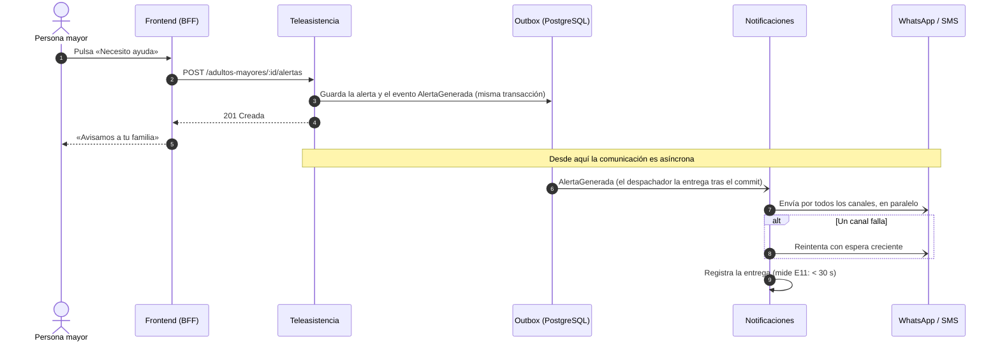

# ADR 003: Estrategia de comunicación

| Campo | Valor |
|---|---|
| **Proyecto** | Seniory — *Creciendo y cuidando juntos* |
| **Equipo de desarrollo** | Michael Stiven Zuleta Hernández, Alejandro Múnera Jaramillo |
| **Curso** | Arquitectura de Software |
| **Fecha** | 2026-10-28 |
| **Estado** | **Propuesto (borrador)** |
| **Complementa a** | [ADR-01](./ADR-01.md) (monolito modular con eventos internos) |

## 1. Contexto

[ADR-01](./ADR-01.md) definió un monolito modular (Identidad, Directorio, Reservas, Pagos, Teleasistencia, Notificaciones, Mensajería e IA) que se comunica con **eventos internos**, y un frontend en Next.js que llama al backend por HTTP. Este ADR decide tres cosas:

1. Por qué la comunicación es **asíncrona**.
2. Con qué **tecnología** se comunican las partes.
3. Cómo se escriben los **contratos** de esa comunicación.

## 2. Decisión

| Pregunta | Decisión |
|---|---|
| Estilo | **Asíncrono entre módulos**: un módulo publica un evento («`ServicioConfirmado`») y sigue; los interesados reaccionan después. Solo es síncrono cuando una persona espera la respuesta en pantalla. |
| Tecnología | **REST** (JSON sobre HTTPS) entre el frontend y el backend. **Eventos por outbox transaccional** en PostgreSQL entre módulos. |
| Contrato | **OpenAPI 3.1** para la API REST y **AsyncAPI 3.0** para los eventos. |

## 3. Por qué la comunicación es asíncrona

| Razón | Ejemplo en Seniory | Escenario |
|---|---|---|
| **Una falla no arrastra a los demás módulos.** El evento queda guardado y se reintenta cuando el destino vuelve. | Si el proveedor de WhatsApp no responde, la reserva igual se confirma; el aviso sale después. | E2 Disponibilidad |
| **Respuesta rápida aunque el destino sea lento.** Quien origina la acción no espera la entrega. | El botón de alerta responde al instante; Notificaciones entrega por SMS y WhatsApp en paralelo. | E11 Alerta < 30 s |
| **Sin pérdidas ni duplicados.** El evento se guarda en la misma transacción que el cambio, y cada receptor registra lo que ya procesó. | Un `PagoAprobado` existe si y solo si el pago se aprobó; un evento repetido produce un solo aviso. | E3 Integridad de pagos |
| **Bajo acoplamiento.** Quien publica no conoce a quienes escuchan; agregar un receptor no cambia al emisor. | Notificaciones escucha a todos los módulos sin que ninguno dependa de ella. | E9, E13 |
| **Facilita separar módulos en el futuro.** Un módulo que ya se comunica por eventos se puede extraer cambiando solo el transporte. | Teleasistencia, si necesita escalar sola (ADR-01 §4.11). | — |

**Lo que sigue siendo síncrono:** las peticiones del frontend (la persona espera «reservado» o «franja ocupada») y las consultas que un módulo necesita para decidir, como la tarifa de un cuidador. Estas últimas son llamadas dentro del mismo proceso, no peticiones de red.

**Costo:** consistencia eventual entre módulos (un aviso llega milisegundos después del cambio), y cada receptor debe ser idempotente.

### Ejemplo: una alerta de teleasistencia

La persona recibe su respuesta en cuanto la alerta queda guardada. La entrega a la familia ocurre después, sin hacerla esperar, y se reintenta si un canal falla.



## 4. Tecnología de comunicación: REST

| Criterio | **REST** ✅ | SOAP | gRPC | GraphQL |
|---|---|---|---|---|
| El frontend lo consume sin librerías especiales | ✅ `fetch` | ❌ Cliente SOAP y XML | ❌ Necesita gRPC-Web y un proxy | ⚠️ Cliente GraphQL |
| Formato legible al depurar | ✅ JSON | ⚠️ XML verboso | ❌ Binario | ✅ JSON |
| Control de acceso y límites por ruta | ✅ Uno por ruta | ✅ | ✅ | ❌ Una sola ruta para todo |
| Soporte en NestJS | ✅ Nativo | ❌ No oficial | ✅ | ✅ |
| Curva de aprendizaje del equipo | Baja | Alta | Media | Media–alta |

**Por qué REST:** es la opción más simple que cumple todo. Next la consume con `fetch`, Nest la trae de fábrica, y la semántica de HTTP ya resuelve errores (códigos de estado), caché, seguridad por ruta y límites por ruta.

**Por qué se descartan las demás:**

- **SOAP:** diseñado para integraciones empresariales con XML y estándares WS-\*. Agrega sobres XML y un WSDL que mantener, Nest no lo soporta, y no aporta nada a una aplicación web. Solo se usaría dentro de un adaptador si un tercero lo exigiera.
- **gRPC:** muy eficiente entre servicios de un centro de datos, pero el navegador no lo habla sin proxy y su ventaja de rendimiento no importa con el volumen de Seniory. Es la opción a considerar si un módulo se extrae y necesita llamadas de alto volumen entre servicios.
- **GraphQL:** útil cuando muchos clientes piden formas distintas de los datos. Seniory tiene un solo cliente (el frontend). Además, complica el control de acceso campo por campo sobre datos de salud (E6) y limitar el costo de cada consulta.

**Para los eventos entre módulos** se usa un **outbox en PostgreSQL** y no un broker (RabbitMQ, Kafka). Ningún broker garantiza solo que el evento exista si y solo si el cambio se confirmó: el outbox haría falta de todos modos. Con él, la base de datos ya funciona como cola confiable, sin un servidor más que operar.

### Tiempo real (chat y alertas): Server-Sent Events

Para que un mensaje o una alerta aparezca sin recargar la página:

- **Enviar** es una petición REST normal: `POST /conversaciones/:id/mensajes`.
- **Recibir** usa **SSE**: el navegador abre `GET /mensajeria/eventos` y el servidor empuja cada mensaje nuevo por esa conexión. Si se corta, el navegador reconecta solo y recupera lo perdido con `Last-Event-ID`. Las alertas usan el mismo mecanismo.

| Opción | Decisión | Motivo |
|---|---|---|
| **SSE** | ✅ | El canal en vivo solo va del servidor al navegador. Lo que envía la persona ya viaja por REST, con su validación, su control de acceso y su contrato. SSE es HTTP normal: usa las mismas cookies, el mismo guard y los mismos logs, y reconecta solo. |
| WebSockets | ❌ | Es bidireccional, algo que no se necesita aquí. Exige su propio protocolo, autenticación y manejo de reconexión y de mensajes perdidos. Se reconsidera si el chat necesita señales muy frecuentes en ambos sentidos («está escribiendo…», presencia en línea, llamadas). |
| Consultar cada pocos segundos (*polling*) | ❌ | Carga constante sobre el servidor y retrasa la alerta hasta la siguiente consulta. |

## 5. Contratos de comunicación: OpenAPI

| Formato | Tecnología | Decisión |
|---|---|---|
| **OpenAPI 3.1** | REST | ✅ **Elegido para la API** |
| **AsyncAPI 3.0** | Mensajería y eventos | ✅ **Elegido para los eventos** (es el equivalente de OpenAPI para la comunicación asíncrona) |
| WSDL | SOAP | ❌ Se descartó SOAP |
| `.proto` | gRPC | ❌ Se descartó gRPC |
| SDL | GraphQL | ❌ Se descartó GraphQL |

**Cómo se aplica:**

- **OpenAPI se genera desde el código** (`@nestjs/swagger` lee los controladores y los DTO). Así el contrato no se desalinea del código.
- **El frontend genera su cliente tipado** desde el documento OpenAPI: si la API cambia de forma incompatible, el frontend no compila.
- **Versionado:** la API vive en `/api/v1`. Agregar algo opcional no cambia la versión; quitar o cambiar algo obliga a publicar `/api/v2`.
- **Los eventos** comparten un sobre común (`id`, `tipo`, `version`, `ocurridoEn`, `idDeCorrelacion`, `datos`) declarado como tipos de TypeScript en `backend/src/compartido/eventos/`. El documento AsyncAPI los describe. Llevan solo IDs, nunca datos personales ni clínicos. Un cambio incompatible sube `version`.

### Ejemplos de contrato

**OpenAPI 3.1: inicio de sesión** (fragmento). El contrato dice qué se envía, qué se responde en cada caso y que los tokens viajan solo en cookies.

```yaml
openapi: 3.1.0
info: { title: API de Seniory, version: '1' }
paths:
  /api/v1/auth/login:
    post:
      summary: Inicia sesión
      requestBody:
        required: true
        content:
          application/json:
            schema:
              type: object
              required: [correo, contrasena]
              additionalProperties: false   # un campo de más (por ejemplo «rol») se rechaza
              properties:
                correo: { type: string, maxLength: 254 }
                contrasena: { type: string, maxLength: 512 }
      responses:
        '200':
          description: Sesión iniciada; los tokens van en cookies HttpOnly, nunca en el cuerpo
          headers:
            Set-Cookie: { schema: { type: string } }
          content:
            application/json:
              schema:
                type: object
                properties:
                  usuario:
                    type: object
                    properties:
                      id: { type: string, format: uuid }
                      nombre: { type: string }
                      correo: { type: string, format: email }
                      rol: { enum: [familiar, adulto_mayor, cuidador, administrador] }
        '401':
          description: Correo o contraseña incorrectos (la misma respuesta en todos los casos)
          content:
            application/problem+json:
              schema: { $ref: '#/components/schemas/Problema' }
        '429':
          description: Más de 10 intentos por minuto desde la misma IP
components:
  schemas:
    Problema:   # RFC 9457
      type: object
      required: [type, title, status, codigo]
      properties:
        type: { type: string }
        title: { type: string }
        status: { type: integer }
        codigo: { type: string }   # estable; lo usa el frontend, p. ej. auth.credenciales_invalidas
        detail: { type: string }
```

**AsyncAPI 3.0: evento `AlertaGenerada`** (fragmento). Es el evento del diagrama de la sección 3: lo publica Teleasistencia y lo consume Notificaciones.

```yaml
asyncapi: 3.0.0
info: { title: Eventos de Seniory, version: 1.0.0 }
channels:
  alertaGenerada:
    address: teleasistencia.alerta_generada
    messages:
      alertaGenerada: { $ref: '#/components/messages/AlertaGenerada' }
operations:
  publicarAlertaGenerada:
    action: send
    channel: { $ref: '#/channels/alertaGenerada' }
components:
  messages:
    AlertaGenerada:
      payload:
        type: object
        required: [id, tipo, version, ocurridoEn, idDeCorrelacion, datos]
        properties:
          id: { type: string, format: uuid }            # clave de idempotencia del receptor
          tipo: { const: teleasistencia.alerta_generada }
          version: { const: 1 }
          ocurridoEn: { type: string, format: date-time }
          idDeCorrelacion: { type: string, format: uuid }
          datos:                                         # solo IDs: nada clínico ni personal
            type: object
            required: [alertaId, adultoMayorId, origen, destinatarios]
            properties:
              alertaId: { type: string, format: uuid }
              adultoMayorId: { type: string, format: uuid }
              origen: { enum: [boton, voz, signos, medicamento] }
              destinatarios: { type: array, items: { type: string, format: uuid } }
```

## 6. Consecuencias

- **Positivas:**
  - Una falla en un proveedor no impide reservar ni pagar.
  - Ningún evento se pierde ni se procesa dos veces.
  - Los contratos son estándares abiertos que entienden personas y herramientas.
- **Negativas:**
  - Hay consistencia eventual entre módulos.
  - Cada receptor de eventos debe ser idempotente.
  - Seguir un flujo que salta entre módulos es más difícil; se mitiga con el ID de correlación en logs y eventos.

## 7. Referencias

1. Roy T. Fielding — [Architectural Styles and the Design of Network-based Software Architectures](https://ics.uci.edu/~fielding/pubs/dissertation/top.htm), cap. 5 (REST)
2. [OpenAPI Specification 3.1.0](https://spec.openapis.org/oas/v3.1.0)
3. [AsyncAPI Specification 3.0.0](https://www.asyncapi.com/docs/reference/specification/v3.0.0)
4. Chris Richardson — [Pattern: Transactional outbox](https://microservices.io/patterns/data/transactional-outbox.html)
5. MDN — [Server-sent events](https://developer.mozilla.org/en-US/docs/Web/API/Server-sent_events)
6. W3C — [SOAP 1.2](https://www.w3.org/TR/soap12/) · [gRPC](https://grpc.io/docs/what-is-grpc/introduction/) · [GraphQL](https://spec.graphql.org/)
