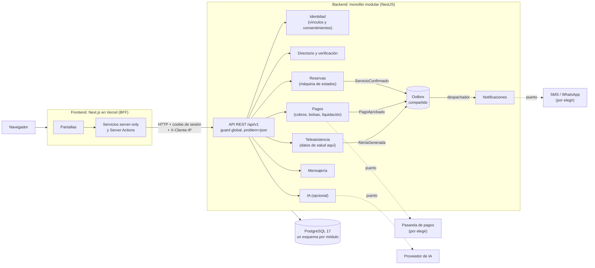

# ADR 004: Stack del backend y decisiones de implementación de la arquitectura

| Campo | Valor |
|---|---|
| **Proyecto** | Seniory — *Creciendo y cuidando juntos* |
| **Equipo de desarrollo** | Michael Stiven Zuleta Hernández, Alejandro Múnera Jaramillo |
| **Curso** | Arquitectura de Software |
| **Fecha** | 2026-10-27 |
| **Estado** | **Propuesto (borrador).** Pasa a *Aceptado* cuando lo revisen y aprueben ambos desarrolladores. |
| **Complementa a** | [ADR-01](./ADR-01.md) (estilo arquitectónico), [ADR-02](./ADR-02.md) (repositorio único) y [ADR-03](./ADR-03.md) (estrategia de comunicación) |
| **Nota** | Se redactó como ADR-03 y se renumeró el 2026-10-28 para dejar ese número a la estrategia de comunicación. |
| **Reemplaza a** | — |

## 1. Contexto

[ADR-01](./ADR-01.md) eligió un **monolito modular por capas con arquitectura hexagonal en cada módulo**, eventos de dominio internos y una máquina de estados para el servicio de cuidado. Dejó abiertas la tecnología del backend y varios detalles de implementación. [ADR-02](./ADR-02.md) dejó `backend/` como marcador de posición, a la espera de este ADR.

Entre el 22 y el 27 de octubre de 2026 se construyó el **módulo M0** (plataforma y compartido) y la **base de datos completa** ([plan del backend](./PLAN_BACKEND_SENIORY.md), [M0](./backend/M0-plataforma-y-compartido.md), [diseño de la base de datos](./backend/BASE_DE_DATOS.md)). Al hacerlo se tomaron decisiones que cambian o precisan lo escrito en ADR-01. Este ADR las registra en un solo lugar.

**Fuerzas en juego** (además de las de ADR-01 §4.2):

- **Es una aplicación real, no una demostración** (decisión del 2026-10-26). Maneja datos de salud y dinero de personas reales, así que nada simulado puede llegar a producción.
- **Equipo de dos personas** con experiencia en TypeScript (el frontend) y conocimientos de Java y programación orientada a objetos.
- **El frontend ya existe** en Next.js y debe conectarse al backend sin reescribir sus pantallas.
- **Las fronteras entre módulos no se cuidan solas**: NestJS no impide que un módulo importe las clases de otro.

## 2. Decisiones

### D1. Lenguaje y framework: TypeScript con NestJS 12

| Elemento | Elección |
|---|---|
| Lenguaje | TypeScript en modo estricto, módulos ES |
| Entorno | Node.js 24 LTS |
| Framework | **NestJS 12** con Express |
| Validación | `class-validator` y `class-transformer` en los DTO |
| Pruebas | Vitest 4 (unitarias, integración y API), Testcontainers, `fast-check` y Supertest |
| Calidad | oxlint (con reglas que usan tipos), `tsc --noEmit`, Prettier y `dependency-cruiser` |

**Por qué:** un solo lenguaje en todo el sistema, con los tipos de TypeScript compartidos entre el frontend y la API. Los **módulos** y la **inyección de dependencias** de Nest corresponden directamente a los módulos y a los puertos y adaptadores de ADR-01. Se usan los valores por defecto de Nest 12 (Express, Vitest y oxlint) porque son los de la documentación oficial y los tutoriales, lo que reduce la curva de aprendizaje.

**Alternativas descartadas:**
- **Java con Spring Boot**, maduro y conocido en parte por el equipo: obliga a mantener dos lenguajes y a duplicar los tipos.
- **Fastify con NestJS**: algo más rápido, pero con menos ejemplos; el rendimiento no es un cuello de botella para Seniory.
- **Python con FastAPI**: un tercer lenguaje para el equipo.

### D2. Persistencia: PostgreSQL 17 y Drizzle ORM, un esquema por módulo

- Un **esquema de Postgres por módulo**: 8 esquemas y 38 tablas.
- **Sin claves foráneas entre esquemas.** Entre módulos solo se guardan IDs; la coherencia se mantiene con puertos y eventos (D7). Una prueba lo verifica.
- Las reglas críticas las hace cumplir **también la base**, con `CHECK`, índices únicos parciales y tres triggers:
  - no hay doble reserva de un cuidador en la misma franja;
  - no hay cobros duplicados;
  - los saldos de la bolsa nunca son negativos;
  - la auditoría y el libro de la bolsa son de solo inserción;
  - un cuidador sin las tres verificaciones vigentes no puede ser visible (E7).
- **IDs UUID v7** generados por la aplicación. **Dinero en `bigint`** (pesos enteros) y **porcentajes en puntos básicos**. **`timestamptz`** para instantes y **`date`** para días de negocio en la zona de Bogotá.
- **Drizzle** porque cada módulo declara su propio esquema en su carpeta, lo que hace visible la frontera de E13. Las migraciones se versionan y no se editan después del primer despliegue.

**Alternativas descartadas:**
- **Prisma**: un esquema único para todo el sistema que difumina las fronteras entre módulos.
- **TypeORM**: mantenimiento irregular.
- **Una base de datos por módulo**: el costo operativo de varias bases sin beneficio a esta escala; además se perderían las transacciones locales que ADR-01 usa para E3.

### D3. Los datos de salud viven en Teleasistencia, no en Identidad

El diagrama de ADR-01 §4.7 pone «Datos de salud aquí» en Identidad, y E6 nombra a Identidad como artefacto. Sin embargo, los medicamentos, las tomas, los signos vitales y las alertas son de Teleasistencia.

**Decisión:** los datos clínicos viven **solo en el esquema `teleasistencia`**. Identidad guarda **quién puede acceder** (vínculos familiar–persona mayor y consentimientos de la Ley 1581), no datos clínicos. **Corrige el diagrama de ADR-01 §4.7 y el artefacto de E6.**

### D4. Nuevo módulo: Mensajería

La mensajería es una funcionalidad del MVP (ADR-01 §1) que no figuraba como módulo en ADR-01 §4.7. **Se agrega el módulo `mensajeria`**, con conversaciones entre una familia y un cuidador y mensajes idempotentes ante reenvíos.

### D5. Las bolsas de horas pertenecen a Pagos

ADR-01 no contempla las bolsas de horas prepagadas. **Se ubican en `pagos`** como un libro contable de solo inserción (compra, reserva, consumo, liberación y ajuste) con su saldo. La unidad de la bolsa (pesos u horas) sigue abierta; el diseño actual usa pesos.

### D6. El frontend Next.js actúa como BFF

El navegador **no llama a la API directamente**: lo hacen los servidores de Next (*Backend for Frontend*), con sus servicios marcados `server-only` y Server Actions.

- Las sesiones viajan en **cookies `HttpOnly`** del dominio del frontend (`seniory_acceso`, `seniory_refresco`). El backend lee la cookie y, solo fuera de producción, también `Authorization: Bearer`.
- Como todas las peticiones llegan desde los servidores del frontend, el backend solo cree en la IP de `X-Cliente-IP` si `X-Seniory-BFF` trae el secreto compartido (comparado en tiempo constante). Nunca confía en `X-Forwarded-For`.

**Por qué:** no expone tokens a JavaScript del navegador, evita CORS y permite que las pantallas de ADR-02 sigan llamando a la misma capa de servicios.

### D7. Comunicación entre módulos: puertos síncronos y eventos por outbox

> El porqué de esta decisión, las alternativas descartadas y los contratos están en el [ADR-03](./ADR-03.md). Aquí queda solo cómo se implementó.

- **Consultas y órdenes síncronas** solo a través de los **puertos de entrada** que cada módulo exporta.
- **Eventos de integración** (por ejemplo, `ServicioConfirmado`) mediante un **outbox transaccional** en `compartido.outbox`:
  1. El evento se guarda en la misma transacción que el cambio que anuncia.
  2. Un despachador lo entrega tras el commit; un sondeo recupera los pendientes.
  3. Varias instancias reclaman con `FOR UPDATE SKIP LOCKED` sin pisarse.
  4. Si falla, se reintenta con espera creciente.
- Cada manejador registra `(manejador, evento)` en `eventos_consumidos` en su propia transacción: **entrega al menos una vez, procesamiento exactamente una vez**.
- **Sin broker de mensajes** (Kafka, RabbitMQ, Redis). A esta escala, la base de datos alcanza y da transacciones locales.
- Un **ID de correlación** (`X-Request-Id`) une la petición, sus logs, sus eventos, las reacciones de otros módulos y la auditoría.

Esto precisa el «bus de eventos internos» de ADR-01 §4.7: no puede perder eventos si el proceso se reinicia.

### D8. Las fronteras se verifican de forma automática

ADR-01 §4.10 acepta que el monolito «no impide romper las fronteras». Se agregan cuatro barreras:

1. **`dependency-cruiser` en la CI**, con siete reglas:
   - sin ciclos;
   - dominio puro;
   - aplicación sin infraestructura;
   - frontera de módulo (solo puertos de entrada);
   - esquemas privados;
   - eventos por contrato;
   - `compartido` sin depender de módulos.

   Cada regla tiene un ejemplo que la rompe a propósito y una prueba que verifica que lo detecta.
2. **`exports` de cada `@Module` limitados a sus puertos de entrada.** Nest falla al arrancar si un módulo inyecta algo que otro no exporta. La regla se verificará con una prueba desde M1.
3. **Sin claves foráneas entre esquemas** (D2).
4. **Un rol de base de datos por módulo**, con permisos solo sobre su esquema (M10).

### D9. Capa HTTP: segura por defecto

- **Autenticación global que deniega por defecto.** Las rutas públicas se marcan con `@Publico()`; un rol insuficiente recibe 403.
- **Errores en `application/problem+json`** con un `codigo` estable y el ID de correlación. Un error 500 nunca expone detalles.
- **Validación en lista blanca.** Un campo no declarado en el DTO se rechaza, para evitar la asignación masiva.
- **Protecciones de entrada:**
  - límite de 100 peticiones por minuto por IP real;
  - `helmet`;
  - cuerpo de hasta 100 KB;
  - CORS cerrado.
- **Logs JSON** que ocultan credenciales y datos personales.
- **Rutas para el hosting y documentación:**
  - `/salud` y `/salud/listo` para los monitores;
  - Swagger, solo fuera de producción.

### D10. Arranque seguro: nada simulado en producción

- La configuración se valida al iniciar. **En producción el arranque falla** si:
  - falta un secreto;
  - algún proveedor está configurado como simulado;
  - los orígenes permitidos incluyen `localhost` o `http`;
  - el log está en `debug`;
  - el sondeo del outbox está apagado.
- **Dos tipos de datos iniciales, que no se mezclan:**
  - **datos de referencia** (franjas, política de precios), que viajan en las migraciones y sí llegan a producción;
  - **fixtures de desarrollo**, que nunca salen del entorno local ni de las pruebas.
- **Sin «línea de emergencia» simulada:** la alerta de teleasistencia avisa a la familia y al cuidador, y la interfaz no promete un despacho que no existe.

### D11. Estructura del backend

Se mantiene la estructura de ADR-01 §4.8, con una carpeta `src/` por convención de Nest:

```text
backend/
├─ src/
│  ├─ compartido/            ← dominio común (Dinero, FechaCivil, Id, errores), puertos,
│  │                           eventos de integración, outbox, auditoría y capa HTTP
│  ├─ <modulo>/              ← identidad, directorio, pagos, reservas, notificaciones,
│  │  ├─ dominio/               teleasistencia, mensajeria
│  │  ├─ aplicacion/{casos-de-uso,puertos/{entrada,salida}}/
│  │  └─ infraestructura/{entrada/rest,salida/persistencia}/
│  ├─ configuracion/         ← variables de entorno validadas
│  └─ salud/                 ← /salud y /salud/listo
├─ pruebas/{unitarias,integracion,api,arquitectura,soporte}/
└─ drizzle/                  ← migraciones
```

Un módulo nuevo queda cubierto por las reglas de D8 sin tocar su configuración.

### D12. Pruebas e integración continua

- **Unitarias** del dominio sin infraestructura (E14), con pruebas de propiedades en el dominio compartido.
- **Integración y API contra un PostgreSQL 17 real** levantado con Testcontainers, no contra imitaciones. Incluyen pruebas de concurrencia (doble reserva, doble alerta, varios despachadores).
- **Cobertura mínima:** 90 % en el dominio compartido y 70 % global.
- **GitHub Actions en cada PR:**
  - lint y formato;
  - arquitectura;
  - unitarias;
  - integración con cobertura;
  - build;
  - auditoría de dependencias.

  Las acciones se fijan por SHA y tienen permisos de solo lectura.
- **Dependabot semanal**, con una semana de espera por versión nueva.

## 3. Vista general actualizada

Reemplaza el diagrama de ADR-01 §4.7 (D3, D4, D6 y D7):



## 4. Cómo responden estas decisiones a los escenarios de calidad

| Escenario | Decisiones | Mecanismo |
|---|---|---|
| **E3** Integridad de pagos | D2, D7 | Claves de idempotencia únicas, avisos de la pasarela únicos, saldos no negativos, libro de solo inserción y transacción local con el outbox. |
| **E6** Datos clínicos protegidos | D3, D9 | Datos de salud en un solo esquema, acceso que deniega por defecto, auditoría de solo inserción escrita fuera de la transacción y logs sin datos personales. |
| **E7** Cuidadores verificados | D2 | Un trigger impide marcar visible a un cuidador sin las tres verificaciones vigentes. |
| **E9** Estados correctos | D2 | `CHECK` de estados y marcas de tiempo, historial de transiciones y bloqueo optimista. |
| **E10** Costo correcto | D2 | Dinero entero, porcentajes en puntos básicos con redondeo definido y desglose congelado con su `CHECK` aritmético. |
| **E11** Alerta en menos de 30 s | D7 | Entrega inmediata tras el commit, sondeo de respaldo y tiempos medibles en la base (`generada_en`, `primera_entrega_en`). |
| **E12** Cambio de proveedor | D1, D10 | Proveedores detrás de puertos; el arranque rechaza adaptadores simulados en producción. |
| **E13** Módulos independientes | D2, D7, D8 | Esquemas sin claves foráneas cruzadas, comunicación por puertos y eventos, y fronteras verificadas en la CI. |
| **E14** Dominio probado en aislamiento | D8, D12 | Regla «dominio puro» y pruebas unitarias sin infraestructura. |

## 5. Consecuencias

### Positivas

- Un solo lenguaje en el frontend y el backend; los contratos se comparten como tipos.
- Las reglas críticas se cumplen aunque el código falle, porque la base también las impone.
- Las fronteras entre módulos se comprueban en cada PR; ya no dependen solo de la revisión humana.
- Ningún evento se pierde ni se procesa dos veces por el mismo manejador, sin la complejidad de operar un broker.
- Las pruebas usan la misma base que producción; los errores de SQL aparecen antes de desplegar.

### Costos y riesgos

- **Consistencia eventual entre módulos:** sin claves foráneas cruzadas, una referencia puede quedar huérfana por un error. Se mitiga con puertos al crear, eventos al cambiar y una verificación periódica opcional (M10).
- **El sondeo del outbox** consulta la base cada segundo. Es barato con su índice parcial, pero es carga constante; con varias instancias se puede pasar a `LISTEN/NOTIFY`.
- **Las pruebas de integración necesitan Docker**, en local y en la CI.
- **Más piezas que entender** (contexto transaccional, outbox, reglas de arquitectura) para un equipo de dos. Se documentan en los planes y en la [guía de estudio de la base de datos](./backend/BASE_DE_DATOS-guia-de-estudio.pdf).
- **El BFF agrega un salto de red** por petición (de Vercel a la API). Conviene alojar la API cerca de la región de Vercel.

## 6. Decisiones abiertas

| Decisión | Afecta | Estado |
|---|---|---|
| Hosting de staging y producción (región y Postgres gestionado con respaldos) | Despliegue (M0 PR 7, M10) | Por decidir; considerar la transferencia internacional de datos (Ley 1581) |
| Pasarela de pagos que acepte el modelo de marketplace y los pagos al cuidador | Pagos (M7) | Por decidir |
| Canal real de alertas (SMS o WhatsApp) | Notificaciones y teleasistencia (M5, M6) | Por decidir |
| Reporte de errores (Sentry) | Operación | Falta la cuenta |
| Cifrado de columnas clínicas | Teleasistencia (M6) | Recomendado para `nombre`, `indicaciones` y `nota` |

Cada una se registrará en un ADR propio cuando se decida.

## 7. Cuándo revisar estas decisiones

- Si el volumen exige **varias instancias** y el sondeo del outbox se vuelve costoso: evaluar `LISTEN/NOTIFY` o un broker.
- Si un módulo necesita **desplegarse por separado** (ADR-01 §4.11): su esquema propio, sin claves foráneas cruzadas, y su comunicación por eventos permiten extraerlo.
- Si Nest o Drizzle dejan de mantenerse activamente, o si una versión mayor rompe la compatibilidad.
- Si el frontend deja de ser el único cliente (por ejemplo, una aplicación móvil): el backend tendría que aceptar tokens fuera de la cookie también en producción.
