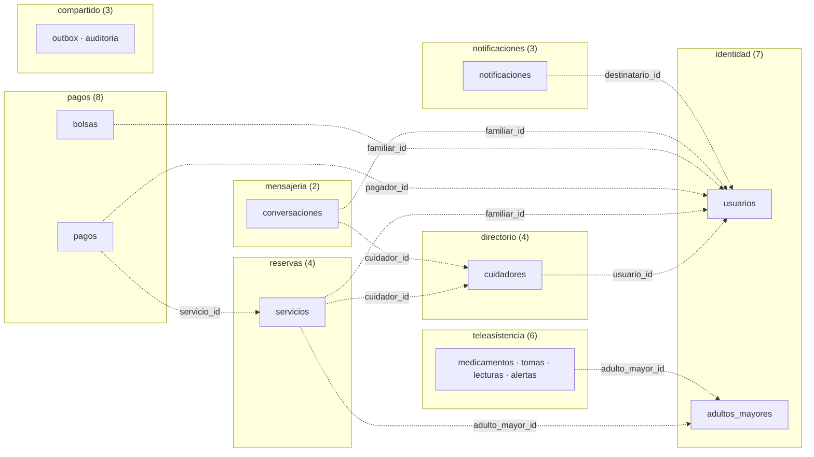
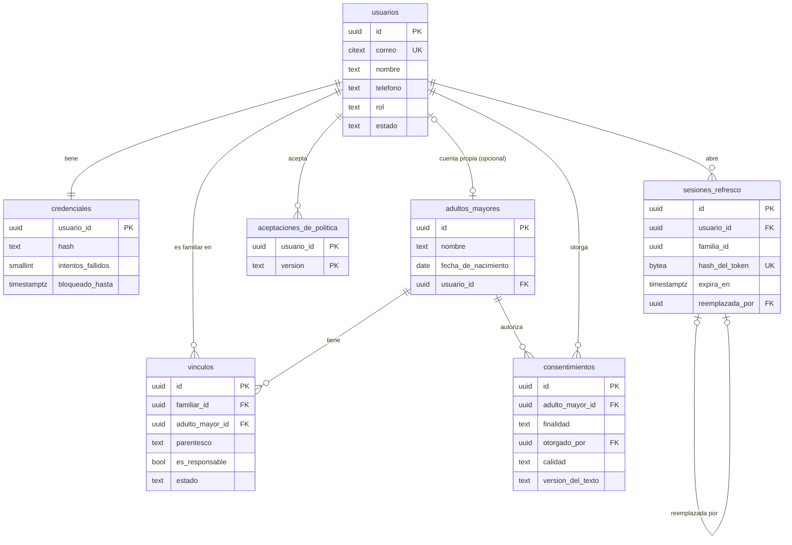
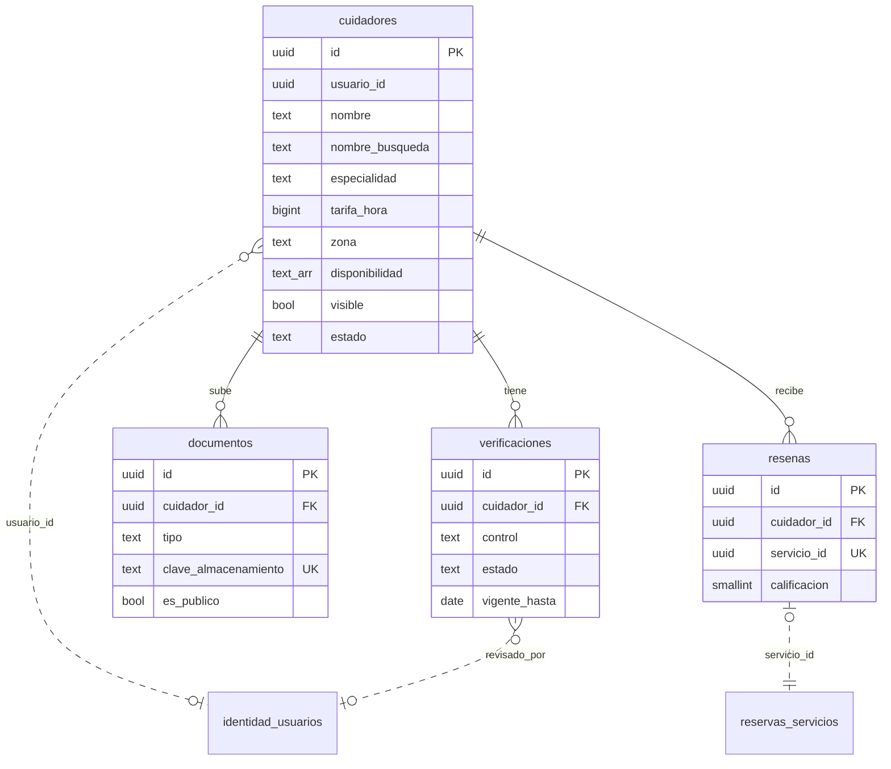
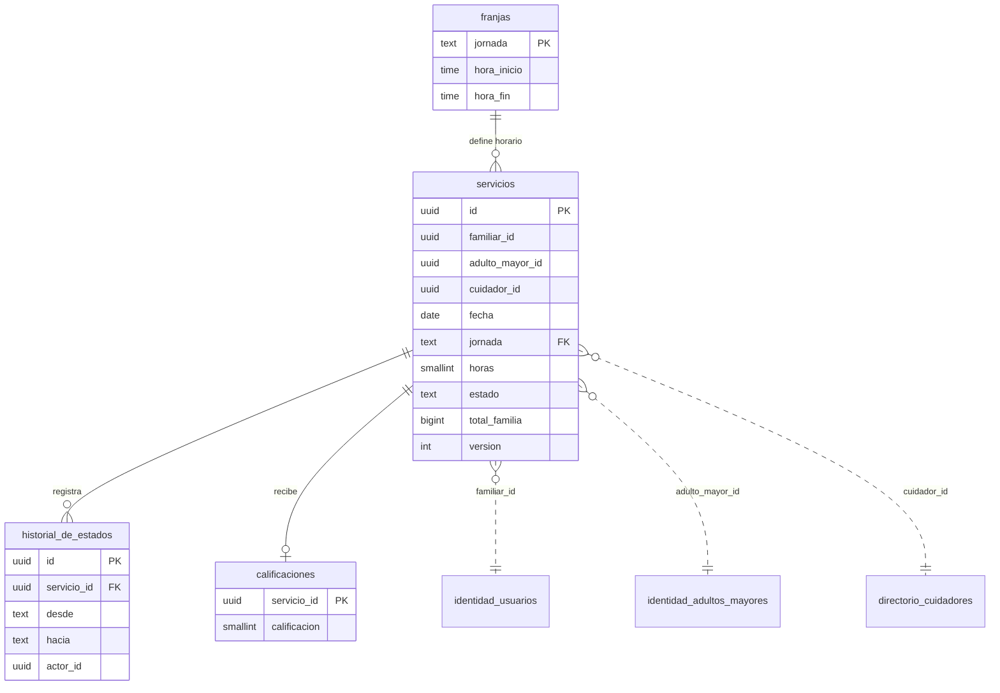
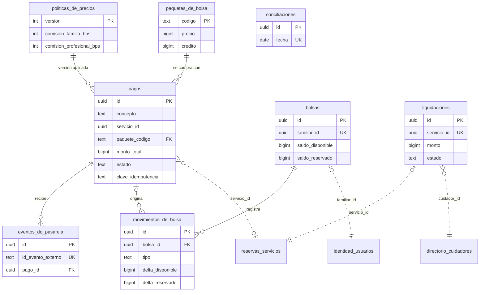
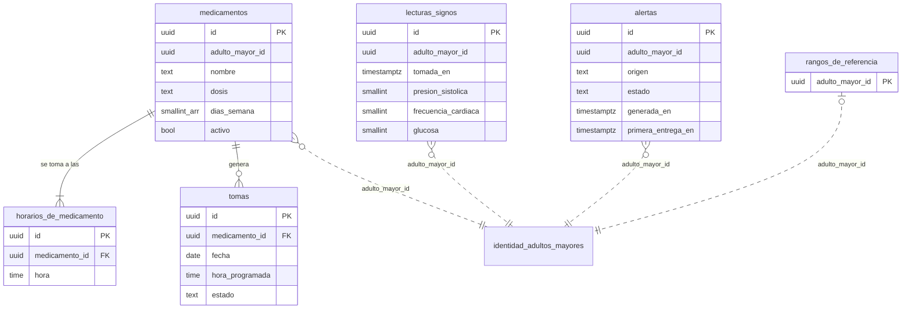

# Seniory — Diseño de la base de datos

| Campo | Valor |
|---|---|
| **Motor** | PostgreSQL 17 (misma versión mayor en local, pruebas y hosting) |
| **Fecha** | 2026-10-24 |
| **Estado** | **Construida** el 2026-10-26 (rama `feat/base-de-datos`): 8 esquemas, 37 tablas, 10 migraciones y 253 pruebas de restricciones contra un Postgres real |
| **Base** | [ADR-01](../ADR-01.md) (un esquema por módulo, ningún módulo lee las tablas de otro, E13) · [PLAN_BACKEND](../PLAN_BACKEND_SENIORY.md) · planes de cada módulo en esta carpeta |

Este documento es el diseño **lógico** completo y **ya está implementado**: los esquemas Drizzle viven en `backend/src/<modulo>/infraestructura/salida/persistencia/<modulo>.esquema.ts` y las migraciones en `backend/drizzle/`. Se construyeron todas juntas, una migración por módulo y en el orden de dependencias, para tener la base completa y probada desde el principio; cada módulo ajusta lo que necesite con migraciones nuevas cuando llegue su turno.

**Qué cambió al construirla** (respecto al diseño original):

| Cambio | Motivo |
|---|---|
| **Tres triggers** de integridad: `compartido.auditoria` y `pagos.movimientos_de_bolsa` son de solo inserción (no admiten UPDATE ni DELETE), y `directorio.cuidadores` no puede marcarse `visible` sin las tres verificaciones aprobadas y vigentes. | Son reglas críticas (E6, E3, E7) que no deben depender solo de que el código no falle. |
| Más reglas `CHECK`: `servicios_solicitud_con_plazo`, `pagos_desglose_de_servicio_coherente`, `pagos_bolsa_se_paga_con_pasarela`, `cuidadores_calificacion_coherente`, `vinculos_revocacion_coherente`, etc. | Cierran estados imposibles que el diseño original dejaba abiertos. |
| Los índices descendentes de columnas `NOT NULL` son `DESC NULLS FIRST` (migración 0009). | Drizzle emite `NULLS LAST` por defecto y Postgres **no usa ese índice** para un `ORDER BY x DESC` normal (medido con 20.000 filas: recorrido completo y ordenamiento en vez de índice). |
| `pagos.paquetes_de_bolsa` queda **vacía**. | Los paquetes y su unidad (pesos u horas) aún no están aprobados por el equipo empresarial. |
| La política de precios v1 (8 % y 10 %) y las franjas horarias van como **datos de referencia** dentro de las migraciones. | Producción las necesita (§9.1). |
| La migración 0001 usa `CREATE SCHEMA IF NOT EXISTS`. | Drizzle emite `CREATE SCHEMA` a secas y la 0000 ya había creado `compartido`. |
| **Política de migraciones.** Antes del primer despliegue a producción se pueden aplanar (reescribir) las migraciones; a partir de ahí, **nunca se editan**. | Mientras no haya datos reales, mantener un historial limpio vale más que conservar cada paso. |

---

## 1. Mapa general

8 esquemas y 37 tablas. **Las flechas entre esquemas son referencias por ID sin clave foránea**: cada módulo es dueño de sus datos y solo conoce los IDs de los demás.

| Esquema | Módulo | Tablas | ¿Datos sensibles? |
|---|---|---|---|
| `compartido` | M0 | `outbox`, `eventos_consumidos`, `auditoria` | Auditoría (IDs, sin datos personales) |
| `identidad` | M1 | `usuarios`, `credenciales`, `sesiones_refresco`, `adultos_mayores`, `vinculos`, `consentimientos`, `aceptaciones_de_politica` | Datos personales |
| `directorio` | M2, M9 | `cuidadores`, `verificaciones`, `documentos`, `resenas` | Datos personales y documentos de identidad |
| `pagos` | M3, M7 | `politicas_de_precios`, `pagos`, `eventos_de_pasarela`, `paquetes_de_bolsa`, `bolsas`, `movimientos_de_bolsa`, `liquidaciones`, `conciliaciones` | Datos financieros (sin tarjetas) |
| `reservas` | M4 | `franjas`, `servicios`, `historial_de_estados`, `calificaciones` | — |
| `notificaciones` | M5 | `notificaciones`, `intentos_de_envio`, `preferencias_de_notificacion` | Contacto (sin datos clínicos) |
| `teleasistencia` | M6 | `medicamentos`, `horarios_de_medicamento`, `tomas`, `lecturas_signos`, `rangos_de_referencia`, `alertas` | **Datos de salud (sensibles, Ley 1581)** |
| `mensajeria` | M8 | `conversaciones`, `mensajes` | Conversaciones privadas |

---

## 2. Convenciones

| Tema | Regla | Motivo |
|---|---|---|
| Nombres | Tablas y columnas en `snake_case`, en español; tablas en plural. | ADR-01 §4.9 (lenguaje del dominio en español). |
| Clave primaria | `id uuid`, generado por la aplicación (UUID v7). | Ordenable por tiempo (buenos índices) y conocido antes de insertar. |
| Referencias dentro del esquema | Clave foránea real, con `ON DELETE RESTRICT` salvo que se indique. | Integridad en la base. |
| Referencias a otro esquema | Columna `uuid` **sin clave foránea**, con sufijo `_id` y comentario del módulo dueño. | E13: ningún módulo depende de las tablas de otro. La coherencia se mantiene con puertos y eventos (§5). |
| Valores cerrados (estados, roles) | `text` con `CHECK (col IN (...))`, no `ENUM` de Postgres. | Agregar un valor es cambiar un `CHECK`, no un `ALTER TYPE`; más simple con migraciones. |
| Dinero | `bigint`, pesos COP enteros, con `CHECK (>= 0)`. | Sin errores de redondeo (PLAN_BACKEND §5). |
| Porcentajes | `integer` en puntos básicos (8 % = 800). | Aritmética entera. |
| Instantes | `timestamptz`, guardados en UTC. | Sin ambigüedad de zona. |
| Fechas de negocio | `date` (día civil en `America/Bogota`) y `time` para horas del día. | Hallazgo H2: «hoy» depende de la zona horaria de Colombia. |
| Auditoría de filas | `creado_en timestamptz NOT NULL DEFAULT now()`; `actualizado_en` donde haya cambios. | — |
| Concurrencia | `version integer NOT NULL DEFAULT 1` en agregados que se editan en paralelo (`servicios`, `pagos`, `bolsas`, `cuidadores`, `tomas`). | Bloqueo optimista. |
| Correos | `citext`. | Unicidad sin distinguir mayúsculas. |
| Teléfonos | `text` con `CHECK (col ~ '^\+[1-9][0-9]{7,14}$')` (E.164). | — |
| Búsqueda sin tildes | Columna normalizada que llena la aplicación (minúsculas, sin tildes) con índice `gin_trgm_ops`. | `unaccent()` no se puede usar directamente en un índice; la columna normalizada es más simple que una función envoltorio. |
| JSON | `jsonb` solo para datos sin estructura fija (eventos, metadatos). Nunca para datos que se filtran o validan. | — |
| Borrado | Sin borrado lógico de datos personales: al eliminar una cuenta se **anonimiza** (§6). | Ley 1581 (supresión). |

**Notación de los diagramas:** línea continua = clave foránea dentro del esquema; línea punteada = referencia por ID a otro esquema (la entidad externa aparece con el prefijo de su esquema).

---

## 3. Esquemas

### 3.1 `compartido` (M0)

| Tabla | Columna | Tipo | Reglas |
|---|---|---|---|
| **outbox** | `id` | uuid | PK (es el id del evento) |
| | `tipo` | text | ej. `reservas.servicio_confirmado` |
| | `version` | integer | versión del esquema de `datos` |
| | `datos` | jsonb | solo IDs y valores necesarios; nunca datos clínicos |
| | `id_de_correlacion` | uuid | |
| | `creado_en` | timestamptz | |
| | `procesado_en`, `fallido_en` | timestamptz | nulos mientras está pendiente |
| | `intentos` | smallint | `DEFAULT 0`, `CHECK (>= 0)` |
| | `proxima_ejecucion` | timestamptz | `DEFAULT now()` |
| | `ultimo_error` | text | |
| **eventos_consumidos** | `manejador`, `evento_id` | text, uuid | PK compuesta: hace idempotente a cada manejador |
| | `consumido_en` | timestamptz | |
| **auditoria** | `id` | uuid | PK |
| | `ocurrido_en` | timestamptz | |
| | `actor_id` | uuid | nulo si es el sistema |
| | `accion` | text | ej. `teleasistencia.leer_signos` |
| | `recurso_tipo`, `recurso_id` | text, text | |
| | `resultado` | text | `CHECK IN ('permitido','denegado','error')` |
| | `id_de_correlacion` | uuid | |
| | `metadatos` | jsonb | sin datos personales |

**Índices:** `outbox (proxima_ejecucion) WHERE procesado_en IS NULL AND fallido_en IS NULL` (lo que busca el sondeo); `auditoria` con índice **BRIN** sobre `ocurrido_en` (crece mucho y se consulta por rangos de tiempo) y B-tree sobre `(recurso_tipo, recurso_id, ocurrido_en)` y `(actor_id, ocurrido_en)`. `auditoria` es solo de inserción: en M10 se le retiran `UPDATE` y `DELETE`.

### 3.2 `identidad` (M1)

| Tabla | Columnas | Restricciones e índices |
|---|---|---|
| **usuarios** | `id`, `correo` citext, `nombre` text, `telefono` text null, `rol` text, `estado` text, `correo_verificado_en` timestamptz null, `creado_en`, `actualizado_en` | `UNIQUE (correo)`; `rol IN ('familiar','adulto_mayor','cuidador','administrador')`; `estado IN ('activo','eliminado')`; `char_length(nombre) BETWEEN 1 AND 100`; E.164 en `telefono` |
| **credenciales** | `usuario_id` PK/FK, `hash` text, `intentos_fallidos` smallint, `bloqueado_hasta` timestamptz null, `actualizado_en` | `intentos_fallidos >= 0`; `ON DELETE CASCADE` desde `usuarios` |
| **sesiones_refresco** | `id`, `usuario_id` FK, `familia_id` uuid, `hash_del_token` bytea, `emitida_en`, `expira_en`, `reemplazada_en` null, `reemplazada_por` uuid null (FK a la misma tabla), `revocada_en` null | `UNIQUE (hash_del_token)`; índices `(familia_id)` y `(usuario_id)`; `expira_en > emitida_en` |
| **adultos_mayores** | `id`, `nombre`, `fecha_de_nacimiento` date, `foto_url` null, `usuario_id` uuid null FK, `creado_por` uuid FK, `creado_en`, `actualizado_en` | `UNIQUE (usuario_id)` (nulos permitidos); la edad se calcula, no se guarda |
| **vinculos** | `id`, `familiar_id` FK, `adulto_mayor_id` FK, `parentesco` text, `es_responsable` bool, `estado` text, `creado_en`, `revocado_en` null | Único parcial `(familiar_id, adulto_mayor_id) WHERE estado = 'activo'`; `parentesco IN ('hijo_hija','nieto_nieta','conyuge','hermano_hermana','otro')`; `estado IN ('activo','revocado')` |
| **consentimientos** | `id`, `adulto_mayor_id` FK, `finalidad` text, `otorgado_por` FK, `calidad` text, `version_del_texto` text, `otorgado_en`, `revocado_en` null | Único parcial `(adulto_mayor_id, finalidad) WHERE revocado_en IS NULL`; `calidad IN ('titular','representante')`; `finalidad IN ('datos_de_salud')` |
| **aceptaciones_de_politica** | `usuario_id` FK, `version` text, `aceptada_en` | PK `(usuario_id, version)` |

**Ventana de gracia del refresco.** Como solo se guarda el hash, no se puede devolver un token ya emitido. Si un token reemplazado hace menos de 30 s se presenta otra vez, se emite **otro par nuevo de la misma familia** (y `reemplazada_por` permite rastrear la cadena). Pasados 30 s, se revoca la familia.

### 3.3 `directorio` (M2 lectura, M9 registro y verificación)

| Tabla | Columnas | Restricciones e índices |
|---|---|---|
| **cuidadores** | `id`, `usuario_id` uuid null (identidad; nulo solo en los fixtures de desarrollo, nunca en producción: todo cuidador real tiene cuenta para aceptar servicios), `nombre`, `nombre_busqueda` (normalizado), `foto_url` null, `especialidad`, `titulo`, `anios_experiencia` smallint, `tarifa_hora` bigint, `telefono` text, `zona` text, `zona_busqueda` (normalizada), `disponibilidad` text[], `bio` text, `aceptacion_automatica` bool `DEFAULT false` (solo el propio cuidador la activa), `estado` text, `visible` bool, `suma_calificaciones` int, `cantidad_resenas` int, `servicios_completados` int, `version`, `creado_en`, `actualizado_en` | `UNIQUE (usuario_id)`; `especialidad IN ('auxiliar','enfermeria','fisioterapia','acompanamiento')`; `tarifa_hora > 0`; `anios_experiencia BETWEEN 0 AND 60`; `disponibilidad <@ ARRAY['manana','tarde','noche'] AND cardinality(disponibilidad) > 0`; `estado IN ('borrador','en_revision','activo','suspendido')`; `char_length(bio) <= 1000`; contadores `>= 0`; E.164 en `telefono` |
| **verificaciones** | `id`, `cuidador_id` FK, `control` text, `estado` text, `revisado_por` uuid null (identidad), `revisado_en` null, `motivo_rechazo` text null, `vigente_hasta` date null, `creado_en` | `control IN ('antecedentes','titulos','psicotecnica')`; `estado IN ('pendiente','aprobada','rechazada','vencida')`; único parcial `(cuidador_id, control) WHERE estado IN ('pendiente','aprobada')`: una sola verificación vigente por control, y las anteriores quedan como historial |
| **documentos** | `id`, `cuidador_id` FK, `tipo` text, `clave_almacenamiento` text, `nombre_original` text, `tipo_mime` text, `tamano_bytes` int, `sha256` bytea, `estado` text, `es_publico` bool, `subido_en` | `UNIQUE (clave_almacenamiento)`; `tipo IN ('cedula','antecedentes','titulo','psicotecnica','hoja_de_vida','foto')`; `tamano_bytes BETWEEN 1 AND 10485760`; `tipo_mime IN ('application/pdf','image/jpeg','image/png')`; `es_publico` solo puede ser verdadero si `tipo IN ('hoja_de_vida','foto') AND estado = 'aprobado'` (H10) |
| **resenas** | `id`, `cuidador_id` FK, `servicio_id` uuid (reservas), `autor_visible` text (ej. «Andrea G.»), `calificacion` smallint, `comentario` text null, `oculta` bool, `creada_en` | `UNIQUE (servicio_id)`: una reseña por servicio, y el manejador del evento es idempotente; `calificacion BETWEEN 1 AND 5`; `char_length(comentario) <= 500` |

**Reglas de diseño**
- **`visible` se guarda** (no se calcula en cada consulta). El dominio la recalcula en la misma transacción que cambia una verificación o el estado. Permite un índice parcial y hace cumplir E7 también en la base.
- **Calificación derivada** (H12): se guardan `suma_calificaciones` y `cantidad_resenas`, y el promedio se calcula al leer. Así no se acumulan errores de redondeo.
- **El teléfono nunca sale del módulo en el listado** (H1); solo lo entrega el puerto `ObtenerContactoDeCuidador`.
- Zona como texto libre por ahora; si el directorio crece, se pasa a un catálogo de barrios y municipios.

**Índices:** parcial `(especialidad, tarifa_hora) WHERE visible`; `GIN (disponibilidad)`; `GIN (nombre_busqueda gin_trgm_ops)` y `GIN (zona_busqueda gin_trgm_ops)`; `(cuidador_id, creada_en DESC)` en `resenas`; `(estado, creado_en)` en `verificaciones` (cola del revisor).

### 3.4 `reservas` (M4)

| Tabla | Columnas | Restricciones e índices |
|---|---|---|
| **franjas** | `jornada` PK, `hora_inicio` time, `hora_fin` time, `cruza_medianoche` bool | `jornada IN ('manana','tarde','noche')`. Horario **decidido el 2026-10-26**: mañana 06–12, tarde 12–18, noche 18–06 (cruza la medianoche) |
| **servicios** | `id`, `familiar_id`, `adulto_mayor_id`, `cuidador_id` (los tres de otros esquemas), `fecha` date, `jornada` FK, `horas` smallint, `estado` text, `medio_de_pago` text, `aceptacion_automatica` bool (copia de la preferencia del cuidador al solicitar), `solicitud_expira_en` timestamptz null (plazo para que el cuidador acepte; la tarea programada cancela con motivo «expirada» los vencidos), **desglose congelado:** `tarifa_hora`, `subtotal`, `cargo_familia`, `total_familia`, `pago_profesional` (bigint), `politica_version` int; `clave_idempotencia` text, `solicitado_en`, `aceptado_en`, `iniciado_en`, `finalizado_en`, `cancelado_en` (null), `cancelado_por` uuid null, `motivo_cancelacion` text null, `version`, `creado_en`, `actualizado_en` | Ver abajo |
| **historial_de_estados** | `id`, `servicio_id` FK, `desde` text null, `hacia` text, `accion` text, `actor_id` uuid null, `ocurrido_en` | Índice `(servicio_id, ocurrido_en)`; una fila por transición válida (trazabilidad de E9) |
| **calificaciones** | `servicio_id` PK/FK, `familiar_id`, `calificacion` smallint, `comentario` text null, `creada_en` | `calificacion BETWEEN 1 AND 5`; `char_length(comentario) <= 500`; la regla «solo si está finalizado» la aplica el dominio |

**Restricciones de `servicios`** (la base respalda las reglas de E9 y E10):

| Regla | Restricción |
|---|---|
| Horas válidas | `CHECK (horas BETWEEN 1 AND 8)` |
| Estados válidos | `CHECK (estado IN ('solicitado','aceptado','en_curso','finalizado','cancelado'))` |
| Desglose coherente | `CHECK (subtotal = tarifa_hora * horas AND total_familia = subtotal + cargo_familia AND pago_profesional <= subtotal)` |
| Marcas de tiempo coherentes | `CHECK (estado <> 'cancelado' OR cancelado_en IS NOT NULL)`; `CHECK (estado NOT IN ('aceptado','en_curso','finalizado') OR aceptado_en IS NOT NULL)`; `CHECK (estado <> 'finalizado' OR finalizado_en IS NOT NULL)` |
| **Sin doble reserva** | Único parcial `(cuidador_id, fecha, jornada) WHERE estado IN ('solicitado','aceptado','en_curso')`: si dos familias reservan a la vez, una recibe 409 |
| Reintentos seguros | `UNIQUE (familiar_id, clave_idempotencia)` |

**Índices:** `(adulto_mayor_id, fecha)` (cuidador en turno); `(familiar_id, creado_en DESC)` (mis servicios); `(cuidador_id, fecha)` (agenda del cuidador).

El desglose se **congela** al solicitar: si cambian la tarifa del cuidador o las comisiones, el servicio conserva el precio con el que se contrató.

### 3.5 `pagos` (M3 cotización, M7 cobro, bolsas y liquidación)

| Tabla | Columnas | Restricciones e índices |
|---|---|---|
| **politicas_de_precios** | `version` int PK, `comision_familia_bps` int, `comision_profesional_bps` int, `vigente_desde` timestamptz, `creada_en` | Comisiones `BETWEEN 0 AND 10000`; dato de referencia (§9.1): versión 1 con 800 y 1000; índice `(vigente_desde DESC)` |
| **pagos** | `id`, `concepto` text, `servicio_id` uuid null (reservas), `paquete_codigo` FK null, `pagador_id` uuid (identidad), `medio` text, `monto_total`, `pago_profesional`, `ingreso_plataforma` (bigint), `politica_version` FK null, `moneda` char(3), `estado` text, `proveedor` text null, `referencia_proveedor` text null, `clave_idempotencia` text, `aprobado_en` null, `version`, `creado_en`, `actualizado_en` | `concepto IN ('servicio','bolsa')`; `(concepto = 'servicio') = (servicio_id IS NOT NULL)`; `(concepto = 'bolsa') = (paquete_codigo IS NOT NULL)`; `medio IN ('pasarela','bolsa')`; `moneda = 'COP'`; `monto_total > 0`; `estado IN ('pendiente','aprobado','rechazado','expirado','reembolsado')`; **`UNIQUE (pagador_id, clave_idempotencia)`** (E3); `UNIQUE (proveedor, referencia_proveedor)`; índice `(servicio_id)` |
| **eventos_de_pasarela** | `id`, `proveedor`, `id_evento_externo`, `pago_id` FK null, `tipo` text, `cuerpo` jsonb, `firma_valida` bool, `recibido_en`, `procesado_en` null | **`UNIQUE (proveedor, id_evento_externo)`**: el mismo aviso de la pasarela se procesa una sola vez (E3). `cuerpo` nunca contiene datos de tarjeta |
| **paquetes_de_bolsa** | `codigo` PK (ej. `10h`), `horas_referencia` smallint, `descuento_bps` int, `credito` bigint, `precio` bigint, `activo` bool | `precio <= credito`; ejemplo: 10 h → crédito $216.000, precio $205.200 (5 %) |
| **bolsas** | `id`, `familiar_id` uuid (identidad), `saldo_disponible` bigint, `saldo_reservado` bigint, `version`, `creada_en`, `actualizada_en` | `UNIQUE (familiar_id)`; **`CHECK (saldo_disponible >= 0 AND saldo_reservado >= 0)`**: la base impide un saldo negativo aunque falle el código |
| **movimientos_de_bolsa** | `id`, `bolsa_id` FK, `tipo` text, `delta_disponible` bigint, `delta_reservado` bigint, `servicio_id` uuid null, `pago_id` FK null, `creado_en` | Ver abajo |
| **liquidaciones** | `id`, `cuidador_id` (directorio), `servicio_id` (reservas), `monto` bigint, `estado` text, `referencia_dispersion` text null, `creada_en`, `pagada_en` null | `UNIQUE (servicio_id)` (una liquidación por servicio, idempotente); `monto > 0`; `estado IN ('pendiente','enviada','pagada','fallida')` |
| **conciliaciones** | `id`, `fecha` date, `total_pasarela`, `total_interno` (bigint), `diferencias` int, `detalle` jsonb, `ejecutada_en` | `UNIQUE (fecha)` |

**Libro de la bolsa.** Cada movimiento se inserta (nunca se edita) y actualiza los saldos de `bolsas` **en la misma transacción**, bloqueando la fila de la bolsa. Las combinaciones válidas se fijan con un `CHECK`:

| `tipo` | `delta_disponible` | `delta_reservado` |
|---|---|---|
| `compra` | positivo | 0 |
| `reserva` (al contratar con bolsa) | negativo | igual al opuesto del disponible |
| `consumo` (al finalizar) | 0 | negativo |
| `liberacion` (al cancelar) | positivo | igual al opuesto del disponible |
| `ajuste` (administrador) | cualquiera | 0 |

Además, único parcial `(bolsa_id, tipo, servicio_id) WHERE servicio_id IS NOT NULL`: reprocesar un evento no reserva ni consume dos veces.

> **Unidad de la bolsa [ABIERTA].** Este diseño usa **pesos** (recomendación de PLAN_BACKEND §10, decisión 2), porque las tarifas van de $18.000 a $35.000 por hora. Si el equipo decide horas, los saldos pasan a minutos y la conversión a pesos se hace al reservar.

### 3.6 `teleasistencia` (M6) — único esquema con datos de salud

| Tabla | Columnas | Restricciones e índices |
|---|---|---|
| **medicamentos** | `id`, `adulto_mayor_id`, `nombre`, `dosis`, `indicaciones` text null, `dias_semana` smallint[], `vigente_desde` date, `vigente_hasta` date null, `activo` bool, `creado_por` uuid, `creado_en`, `actualizado_en` | `dias_semana <@ ARRAY[1,2,3,4,5,6,7] AND cardinality(dias_semana) > 0` (1 = lunes); `vigente_hasta IS NULL OR vigente_hasta >= vigente_desde`; índice `(adulto_mayor_id) WHERE activo` |
| **horarios_de_medicamento** | `id`, `medicamento_id` FK (`ON DELETE CASCADE`), `hora` time | `UNIQUE (medicamento_id, hora)` |
| **tomas** | `id`, `medicamento_id` FK, `adulto_mayor_id` (copia para consultar el día sin unir tablas), `fecha` date, `hora_programada` time, `estado` text, `registrada_por` uuid null, `registrada_en` null, `version`, `creada_en` | **`UNIQUE (medicamento_id, fecha, hora_programada)`**: generar las tomas del día es idempotente; `estado IN ('pendiente','tomada','omitida')`; `estado <> 'tomada' OR registrada_en IS NOT NULL`; índice `(adulto_mayor_id, fecha)` |
| **lecturas_signos** | `id`, `adulto_mayor_id`, `tomada_en` timestamptz, `presion_sistolica`, `presion_diastolica`, `frecuencia_cardiaca`, `glucosa` (smallint, nulos permitidos), `fuera_de_rango` bool, `fuente` text, `registrada_por` uuid null, `creada_en` | Al menos una medida no nula; sistólica y diastólica van juntas y `presion_diastolica < presion_sistolica`; rangos plausibles: sistólica 50–260, diastólica 30–160, frecuencia 20–250, glucosa 20–600 mg/dL; `fuente IN ('manual','dispositivo')`; índice `(adulto_mayor_id, tomada_en DESC)` |
| **rangos_de_referencia** | `adulto_mayor_id` PK, mínimos y máximos de cada medida (smallint null), `definidos_por` uuid, `actualizados_en` | Mínimo menor que máximo en cada par. Sin fila = rangos por defecto. **Los valores los define un profesional de salud** **[ABIERTA]** |
| **alertas** | `id`, `adulto_mayor_id`, `origen` text, `estado` text, `generada_por` uuid, `clave_idempotencia` text, `generada_en`, `primera_entrega_en` null, `atendida_por` uuid null, `atendida_en` null, `nota` text null | `origen IN ('boton','voz','signos','medicamento')`; `estado IN ('generada','notificada','atendida')`; **`UNIQUE (generada_por, clave_idempotencia)`**: un reintento por mala conexión no crea dos alertas (H7); índice `(adulto_mayor_id, generada_en DESC)` |

**Por qué los signos permiten medidas nulas:** el MVP muestra lecturas completas, pero en la práctica un cuidador puede medir solo la presión. El frontend debe tolerar medidas vacías (H8).

**E11 se mide en la base:** `primera_entrega_en − generada_en` en `alertas`, con la meta de menos de 30 s en el 95 % de los casos.

**Protección adicional:** este esquema es candidato a cifrado de columnas (`nombre` e `indicaciones` del medicamento revelan diagnósticos; `nota` de la alerta) **[ABIERTA]**. Toda lectura queda en `compartido.auditoria` (E6).

### 3.7 `notificaciones` (M5)

| Tabla | Columnas | Restricciones e índices |
|---|---|---|
| **notificaciones** | `id`, `destinatario_id` (identidad), `evento_id` uuid, `tipo` text, `prioridad` text, `canal` text, `estado` text, `parametros` jsonb (**sin datos clínicos**), `intentos` smallint, `proximo_intento_en`, `creada_en`, `enviada_en` null, `entregada_en` null, `ultimo_error` null | `prioridad IN ('normal','alta')`; `canal IN ('app','correo','sms','whatsapp','push')`; `estado IN ('pendiente','enviada','entregada','fallida')`; **`UNIQUE (evento_id, destinatario_id, tipo, canal)`**: reprocesar un evento no repite el aviso; índice parcial `(proximo_intento_en) WHERE estado = 'pendiente'`; índice `(destinatario_id, creada_en DESC)` (campana) |
| **intentos_de_envio** | `id`, `notificacion_id` FK, `intentado_en`, `resultado` text, `respuesta_proveedor` text null | `resultado IN ('exito','error')` |
| **preferencias_de_notificacion** | `usuario_id` PK, `canales` text[], `silencio_desde` time null, `silencio_hasta` time null | Las alertas de teleasistencia ignoran el horario silencioso |

### 3.8 `mensajeria` (M8)

| Tabla | Columnas | Restricciones e índices |
|---|---|---|
| **conversaciones** | `id`, `familiar_id` (identidad), `cuidador_id` (directorio), `creada_en`, `ultimo_mensaje_en` null | **`UNIQUE (familiar_id, cuidador_id)`**: «obtener o crear» sin duplicados; índices `(familiar_id, ultimo_mensaje_en DESC)` y `(cuidador_id, ultimo_mensaje_en DESC)` |
| **mensajes** | `id`, `conversacion_id` FK, `autor_id` uuid, `autor_rol` text, `texto` text, `id_de_cliente` uuid, `creado_en`, `leido_en` null | `autor_rol IN ('familiar','cuidador')`; `char_length(texto) BETWEEN 1 AND 1000`; **`UNIQUE (conversacion_id, autor_id, id_de_cliente)`**: un reenvío no duplica el mensaje; índice `(conversacion_id, creado_en DESC, id)` (paginación por cursor) |

---

## 4. Cómo la base hace cumplir los escenarios de calidad

| Escenario | Mecanismo en la base |
|---|---|
| **E3** 0 cobros duplicados | `UNIQUE (pagador_id, clave_idempotencia)` en `pagos`; `UNIQUE (proveedor, id_evento_externo)` en `eventos_de_pasarela`; saldos de bolsa no negativos; movimientos únicos por servicio. |
| **E6** Datos clínicos protegidos | Solo en `teleasistencia`; toda lectura y negación en `compartido.auditoria`; en M10, un rol de base por módulo. |
| **E7** Cuidadores no verificados ocultos | Columna `visible` mantenida por el dominio; índice parcial que solo incluye visibles; una sola verificación vigente por control. |
| **E9** Estados correctos | `CHECK` de estados y marcas de tiempo; `historial_de_estados`; `version` para bloqueo optimista. |
| **E10** Costo correcto | Desglose congelado con `CHECK` de coherencia aritmética. |
| **E11** Alerta en menos de 30 s | `generada_en` y `primera_entrega_en` medibles; `UNIQUE` de idempotencia. |
| **E13** Módulos independientes | Un esquema por módulo, sin claves foráneas entre esquemas; en M10, cada módulo con su propio rol y permisos solo sobre su esquema. |
| Doble reserva | Único parcial `(cuidador_id, fecha, jornada)` en estados activos. |

---

## 5. Coherencia entre módulos (sin claves foráneas)

Al no haber claves foráneas entre esquemas, la coherencia se mantiene así:

| Situación | Cómo se resuelve |
|---|---|
| Crear algo que apunta a otro módulo (ej. un servicio a un cuidador) | El caso de uso consulta el **puerto de entrada** del otro módulo antes de guardar (¿existe?, ¿está visible?). |
| El otro módulo cambia (ej. el cuidador deja de estar visible) | Publica un **evento** y los módulos interesados reaccionan (por ejemplo, Reservas revisa servicios futuros de ese cuidador). |
| Se elimina una cuenta | `identidad.cuenta_eliminada` → cada módulo anonimiza sus datos de ese usuario (§6). |
| Referencias huérfanas por un error | Consulta de verificación periódica (opcional, M10) que lista IDs sin dueño. |

---

## 6. Ciclo de vida de los datos (Ley 1581)

| Dato | Retención | Al eliminar la cuenta |
|---|---|---|
| `usuarios` | Mientras la cuenta exista | `nombre` → «Usuario eliminado», `correo` → `eliminado+<id>@invalido`, `telefono` → nulo, `estado` → `eliminado` |
| `sesiones_refresco` | Se borran 30 días después de vencer | Se revocan y se borran |
| `adultos_mayores` y datos de `teleasistencia` | **[ABIERTA]** con asesoría legal | Si ningún familiar queda vinculado: anonimizar `adultos_mayores` y borrar medicamentos, tomas, lecturas y alertas |
| `consentimientos` | Se conservan como prueba de la autorización | Se marcan revocados; no se borran |
| `servicios`, `pagos`, `liquidaciones` | Obligaciones contables y tributarias **[ABIERTA]** | Se conservan con IDs; el nombre ya está anonimizado en `identidad` |
| `mensajes` | **[ABIERTA]** (propuesta: 12 meses tras el último servicio) | Texto reemplazado por «Mensaje eliminado» |
| `resenas` | Mientras el cuidador esté activo | `autor_visible` → «Familia de Seniory» |
| `auditoria` | **[ABIERTA]** (propuesta: 2 años) | Se conserva (solo IDs) |

---

## 7. Volumen esperado y rendimiento

Estimación para el piloto en el Valle de Aburrá (500 familias, 100 cuidadores):

| Tabla | Filas al año (aprox.) | Consecuencia |
|---|---|---|
| `lecturas_signos` | 500 × 4 al día ≈ 730 000 | Índice `(adulto_mayor_id, tomada_en DESC)` basta; sin particiones |
| `tomas` | 500 × 3 al día ≈ 550 000 | Índice `(adulto_mayor_id, fecha)` basta |
| `auditoria` | Varios millones | Índice BRIN por tiempo; particionar por mes si supera ~50 millones |
| `servicios` | Decenas de miles | Sin preocupación |

**No se necesitan particiones, réplicas de lectura ni Redis** en esta etapa. Las consultas críticas (búsqueda de cuidadores, resumen de teleasistencia, cuidador en turno) se revisan con `EXPLAIN ANALYZE` en su módulo.

---

## 8. Roles de base de datos (M10)

| Rol | Permisos |
|---|---|
| `seniory_migraciones` | Dueño de todos los esquemas; solo lo usa la CI al migrar. |
| `seniory_<modulo>` (uno por módulo) | `USAGE` sobre su esquema y `SELECT/INSERT/UPDATE/DELETE` sobre sus tablas; `INSERT` en `compartido.outbox`, `compartido.eventos_consumidos` y `compartido.auditoria`. |
| `seniory_lectura` | Solo lectura, para soporte y reportes; **sin acceso** a `teleasistencia` ni a `identidad.credenciales`. |

Así, aunque el código tuviera un error, un módulo **no podría** leer las tablas de otro: E13 queda garantizado por la base, no solo por la revisión de código.

---

## 9. Datos iniciales: de referencia y de desarrollo

La aplicación es real, así que se separan dos clases de datos y **nunca se mezclan**:

### 9.1 Datos de referencia (van a producción, dentro de migraciones)

Son parte de la configuración del negocio; sin ellos la aplicación no funciona.

| Dato | Tabla | Nota |
|---|---|---|
| Franjas horarias | `reservas.franjas` | Horarios decididos el 2026-10-26 (§3.4) |
| Política de precios versión 1 | `pagos.politicas_de_precios` | 800 y 1000 puntos básicos, aprobados por el equipo empresarial |
| Paquetes de bolsa | `pagos.paquetes_de_bolsa` | 10, 20 y 40 horas, con los descuentos que apruebe el equipo empresarial (los de la landing son «ilustrativos») |
| Textos legales vigentes | Configuración de la aplicación | Versión de la política y del consentimiento (M1) |

### 9.2 Datos reales que entran por procedimiento (no por semilla)

| Dato | Cómo entra |
|---|---|
| Administradores | `npm run crear-admin` en cada entorno |
| Cuidadores iniciales | `npm run cuidadores:importar` sobre un archivo revisado por un administrador; crea el cuidador, su cuenta con rol `cuidador` y las verificaciones aprobadas offline con su vigencia (M2). Luego, registro autónomo y revisión (M9) |
| Familias y personas mayores | Registro por la aplicación (M1) |

### 9.3 Fixtures de desarrollo (solo local, pruebas y staging; **nunca producción**)

`npm run semillas` se niega a ejecutarse con `NODE_ENV=production` y la CI verifica que ninguna migración los incluya.

| Origen (frontend) | Destino | Nota |
|---|---|---|
| `data/familia.json` | `identidad.usuarios`, `adultos_mayores`, `vinculos`, `consentimientos` | Usuario de prueba; la contraseña viene de una variable de entorno |
| `data/cuidadores.json` | `directorio.cuidadores`, `verificaciones`, `resenas`, `documentos` | Los ids se derivan con UUID v5 del id antiguo; `suma_calificaciones` y `cantidad_resenas` se calculan de las reseñas. **Revisar antes de usarlos** que los teléfonos del JSON no pertenezcan a personas reales |
| `data/medicamentos.json`, `data/signos-vitales.json` | `teleasistencia.*` | Las fechas se mueven para que terminen «hoy» |
| `data/mensajes.json` | `mensajeria.*` | — |

Cada módulo borra del frontend el JSON que reemplaza al conectarse; estos fixtures viven en `backend/semillas/` solo para desarrollo.

---

## 10. Orden de creación

Cada módulo tiene su propia migración; ninguno depende de las tablas de otro. El orden de los archivos sigue las dependencias (`backend/drizzle/`): `0000` extensiones, `0001` compartido, `0002` identidad, `0003` directorio, `0004` pagos, `0005` reservas, `0006` notificaciones, `0007` teleasistencia, `0008` mensajería y `0009` índices descendentes. Orden previsto de uso por módulo:

`compartido` (M0) → `identidad` (M1) → `directorio` (M2) → `pagos.politicas_de_precios` (M3) → `reservas` (M4) → `notificaciones` (M5) → `teleasistencia` (M6) → resto de `pagos` (M7) → `mensajeria` (M8) → columnas y tablas de verificación de `directorio` (M9) → roles y permisos (M10).

---

## 11. Decisiones abiertas

| # | Decisión | Afecta | Recomendación |
|---|---|---|---|
| 1 | Unidad de la bolsa: pesos u horas | `pagos.bolsas`, `movimientos_de_bolsa`, `paquetes_de_bolsa` | Pesos |
| 2 | ~~Horario de cada franja~~ | `reservas.franjas` | **Resuelto (2026-10-26):** mañana 06–12, tarde 12–18, noche 18–06 |
| 3 | Rangos de referencia de signos vitales | `teleasistencia.rangos_de_referencia` | Definidos por un profesional de salud |
| 4 | Cifrado de columnas clínicas | `teleasistencia` | Sí para `nombre`, `indicaciones` y `nota`; decidir entre `pgcrypto` y cifrado en la aplicación en M6 |
| 5 | Plazos de retención (§6) | Varios | Con asesoría legal antes de producción |
| 6 | Catálogo de zonas | `directorio.cuidadores` | Texto libre hasta que el directorio crezca |
